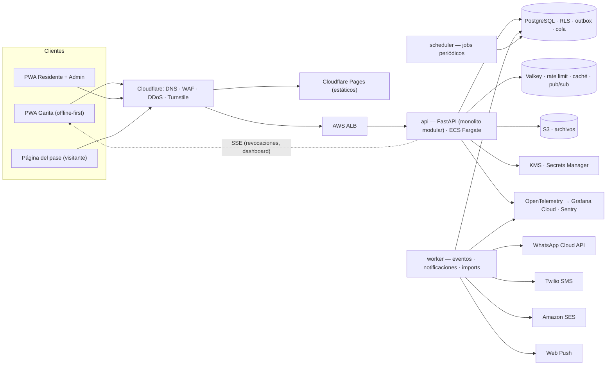

# Atrio — Especificación de producto y arquitectura

> **Atrio** es el nombre elegido (ver `BRAND.md`; registro de marca y dominio pendientes, `DECISIONS.md` Q-01). Código interno: `atrio`.

| Campo | Valor |
|---|---|
| Versión | 1.0 — 2026-10-08 |
| Estado | Borrador para revisión del dueño del producto |
| Fuentes | `condo_mvp_prompt_v2.md`, `prompt_fases_avanzadas_condominios_v2.md`, requisito adicional: *"herramienta de puerta de entrada a residencias → alta capa de seguridad"* |
| Documentos hermanos | `AGENTS.md` (cómo trabajan los agentes), `DECISIONS.md` (ADRs y preguntas abiertas con defaults), `BRAND.md`, `KICKOFF.md` |

---

## 0. Cómo usar este documento

- **Fuente de verdad.** Precedencia ante conflicto: `DECISIONS.md` (decisiones más recientes) > `SPEC.md` > issue > código existente.
- **Palabras clave.** **DEBE** = obligatorio. **DEBERÍA** = recomendado; desviarse requiere justificación escrita en el PR. **PUEDE** = opcional.
- **IDs de requisito.** Cada requisito tiene un ID (`ACC-04`, `SEC-21`…). Todo issue y PR DEBE citar los IDs que implementa o afecta.
- **Fases.** La **Fase 1 (MVP) se construye.** Las Fases 2–4 se **diseñan** aquí (§14) solo para que el modelo de datos, los permisos y los eventos de la Fase 1 no las bloqueen. **No se implementan** hasta que `DECISIONS.md` las habilite.
- **Ambigüedad.** Si un requisito es ambiguo: (1) buscar el default en `DECISIONS.md` §Preguntas abiertas; (2) si no existe, abrir issue `needs-decision` con opciones y recomendación, y continuar con otra tarea. **Nunca** asumir en: seguridad, dinero, permisos, retención de datos o temas legales.

---

## 1. Visión, problema y principios

### 1.1 Problema
En Guatemala y LATAM la administración de condominios es manual y poco digital:
- Control de accesos deficiente, sin trazabilidad ni registro auditable de quién entra y sale.
- Comunicación desordenada (grupos de WhatsApp, papel).
- Cobros y conciliación en Excel o cuadernos; desconfianza residente ↔ administración.
- Administradores con baja alfabetización tecnológica; guardias que requieren interfaces extremadamente simples.
- Conectividad inestable, sobre todo en garitas y áreas comunes.

### 1.2 Propuesta
Plataforma SaaS multi-tenant que digitaliza **la puerta de entrada** del residencial (accesos con QR/código, modo offline) y luego **la vida administrativa** (comunicados, pagos, reservas, mensajería, automatizaciones), con activación autoservicio en menos de 2 horas.

### 1.3 Principios de producto (orden de prioridad)
1. **P1 — Seguridad por diseño.** El sistema decide quién entra a hogares. Ante conflicto entre comodidad y seguridad gana la seguridad; la fricción se compensa con buen UX, no relajando controles.
2. **P2 — Simplicidad extrema por rol.** El guardia ve 3 botones (Escanear QR · Ingresar código · Sin pase; `DECISIONS.md` Q-33). El residente crea una visita en < 20 s. El admin activa su residencial sin llamar a soporte.
3. **P3 — La garita nunca se detiene.** Sin internet, la garita sigue validando de forma segura y sincroniza después.
4. **P4 — Trazabilidad total.** Toda acción relevante queda en una bitácora inmutable y verificable.
5. **P5 — WhatsApp es canal de distribución, no de conversación.** Notificamos por WhatsApp y llevamos la acción a la app.
6. **P6 — No es un ERP.** Cuentas por cobrar por unidad, sí; contabilidad general, no.
7. **P7 — Autoservicio y bajo soporte.** Plantillas, presets, validaciones claras y reportes de error accionables.
8. **P8 — Crecer sin sobreingeniería.** Monolito modular con fronteras estrictas; se extrae un servicio solo cuando una métrica lo exige.

### 1.4 Diferenciales
- Activación < 2 horas (plantillas + Excel + invitaciones distribuidas).
- Seguridad verificable: QR firmados criptográficamente, dispositivos de garita enrolados, bitácora a prueba de manipulación, MFA para administradores.
- Garita offline-first.
- UX de guardia de 3 botones con feedback a pantalla completa.
- Cada visitante es un touchpoint de marca (loop viral).

### 1.5 Contexto competitivo (honesto)
El acceso por QR ya es un commodity en la región (Residentia, AdminCondo, Dostop, VisitaSmart, CRGate, PaseQR, entre otros). Atrio no compite por "tener QR": compite por **activación más rápida, seguridad demostrable, operación offline y enfoque en la realidad guatemalteca**. Toda decisión de producto que no refuerce uno de estos ejes es candidata a recortarse.

### 1.6 Restricciones
- Viable en LATAM: costos de infraestructura y de mensajería (WhatsApp/SMS) contenidos.
- Conectividad intermitente como caso normal, no excepcional.
- Minimizar fricción en todos los roles.
- Preparar estructura para fases futuras sin construirlas antes de tiempo.

---

## 2. Glosario (lenguaje ubicuo)

El código, la UI, los issues y la documentación DEBEN usar estos términos. En código se usa el término en inglés de la columna "Código".

| Término | Código | Definición |
|---|---|---|
| Residencial | `residential` | Entidad raíz y *tenant*: condominio, torre, ofibodega o colonia cerrada. |
| Sector | `sector` | Agrupación opcional dentro de un residencial: torre, fase, cluster. Admite un nivel de anidación. |
| Unidad | `unit` | Casa, apartamento, oficina, bodega o local. Código único dentro del residencial. Las obligaciones financieras pertenecen a la unidad, no a la persona. |
| Garita | `gate` | Punto de control de acceso físico (vehicular, peatonal o mixto). |
| Usuario | `user` | Persona con cuenta. Identidad global (cross-tenant), identificada por teléfono. |
| Membresía | `membership` | Vínculo usuario ↔ residencial ↔ rol. Los roles **nunca** son globales. |
| Asignación de unidad | `unit_assignment` | Vínculo membresía de residente ↔ unidad, con sub-rol: propietario, inquilino o familiar. |
| Admin | `admin` | Control total de un residencial. Puede haber varios. |
| Residente | `resident` | Usuario asociado a una o más unidades. |
| Guardia | `guard` | Usuario operativo asignado a garitas. |
| Dispositivo de garita | `guard_device` | Teléfono/tablet enrolado criptográficamente a una garita. Los guardias inician turno en él con PIN. |
| Invitación | `invitation` | Código que permite a una persona registrarse y solicitar asociación a una unidad. |
| OTP | `otp` | Código de un solo uso para verificar el teléfono (WhatsApp → SMS → email). |
| Visita | `visit` | Autorización creada por un residente (o admin) para un visitante, con vigencia y número máximo de usos. |
| Pase | `pass` | Lo que recibe el visitante: link con QR firmado + código numérico. |
| Visitante | `visitor` | Persona externa sin cuenta. |
| Acceso | `access_log` | Registro auditado de cada validación en garita (exitosa, denegada o error). |
| Acceso manual | `manual_override` | Ingreso sin pase válido registrado por el guardia, con justificación obligatoria y notificación inmediata. |
| Paquete offline | `offline_bundle` | Conjunto firmado de datos mínimos que el dispositivo de garita usa para validar sin conexión. |
| Comunicado | `announcement` | Mensaje oficial one-way del admin, segmentable, con confirmación de lectura opcional. |
| Step-up | `step_up` | Re-autenticación reciente (passkey/TOTP) exigida para acciones sensibles. |
| Break-glass | `support_access` | Acceso excepcional, temporal y auditado del personal de la plataforma a datos de un residencial. |
| Módulo / entitlement | `module` | Funcionalidad activable por residencial (accesos, comunicados, pagos, reservas, mensajería, automatizaciones). |
| Cargo | `charge` | Obligación financiera de una unidad: cuota, extraordinaria, multa, mora, reserva. |
| Pago | `payment` | Abono contra uno o más cargos. Puede ser parcial. |
| Asignación de pago | `payment_allocation` | Qué parte de un pago se aplica a qué cargo. |
| Ledger | `ledger_entry` | Bitácora financiera append-only por unidad; fuente de los saldos. |
| Estado de cuenta | `account_statement` | Vista calculada: cargos − pagos ± ajustes = saldo. No es tabla. |
| Conciliación | `reconciliation` | Validar que un pago reportado corresponde a un ingreso real. |
| Comprobante (evidencia) | `payment_proof` | Foto/PDF que sube el residente como evidencia de su pago. |
| Constancia de pago | `payment_receipt` | Documento generado por el sistema al conciliar un pago. **No es factura.** |
| Mora / recargo | `late_fee` | Cargo por vencimiento según reglas configurables. |
| FEL | `fel` | Factura Electrónica en Línea (SAT Guatemala). |
| Área común | `common_area` | Espacio reservable: exclusiva (bloquea el espacio) o de capacidad compartida (slots). |
| Reserva | `reservation` | Bloqueo temporal de un área a favor de una unidad, con o sin costo. |
| Conversación | `conversation` | Hilo bidireccional con contexto (pago, reserva, visita, mantenimiento). |
| Encuesta | `poll` | Consulta simple con opciones y quórum. Consultiva salvo que el reglamento diga otra cosa. |
| Junta directiva | `board_member` | Rol consultivo/aprobador de copropietarios electos. |
| Tesorero | `treasurer` | Rol financiero: cargos, pagos, conciliación y reportes; no administra residentes. |
| Recepcionista | `receptionist` | Como guardia, con mensajería y registro asistido de visitas. |
| Proveedor | `provider` | Persona o empresa externa con acceso temporal y recurrente; sin capacidades de residente. |
| Preset de automatización | `automation_preset` | Regla predefinida en código que el admin activa y parametriza. |

---

## 3. Alcance por fases

| Fase | Contenido | Estado |
|---|---|---|
| **Fase 1 — MVP** | Estructura, carga Excel, registro de residentes con invitación + OTP, control de accesos QR/código, **visitas sin pase con registro de documento y autorización en vivo del residente**, registro de salidas, flujo del visitante, garita offline, comunicados + push, dashboard admin, ciclos de vida, seguridad base completa. | **Construir** |
| **Fase 1.5 — Endurecimiento post-piloto** | Lectura del documento con cámara, restricciones por unidad, alertas de permanencia, pases recurrentes (empleadas domésticas, niñeras), passkeys para residentes, app envuelta en Capacitor (push iOS confiable, Play Integrity, modo kiosko). | Diseñar; construir tras piloto |
| **Fase 2 — Plataforma + Pagos** | Entitlements, RBAC extendido (tesorero, junta), motor de automatizaciones (núcleo + presets financieros), preferencias de notificación, pagos (cargos masivos, saldos iniciales, comprobantes, conciliación con doble control, estado de cuenta, reportes, exportación FEL). | Diseñado en §14 |
| **Fase 3 — Reservas + pagos en línea** | Áreas exclusivas y de capacidad compartida, aprobación, cobro vía cargos, lista de espera, no-show; una pasarela de pago; mora automática. | Diseñado en §14 |
| **Fase 4 — Mensajería** | Comunicados con confirmación, chat 1:1 con contexto, encuestas, distribución por plantillas de WhatsApp, digest; FEL directo si hay demanda. | Diseñado en §14 |

**Fuera de alcance de la Fase 1:** pagos, reservas, chat 1:1, reportes avanzados, junta directiva como rol formal, proveedores/personal de servicio como rol, FEL, integración con talanqueras/hardware.

---

## 4. Roles, membresías y permisos

### 4.1 Modelo
- **ROL-01** El rol NO es atributo global del usuario. Se modela como `membership(user, residential, role)`; un usuario puede ser admin en un residencial y residente en otro, o **ambos en el mismo** (caso común: el admin vive ahí). Restricción: `UNIQUE(user_id, residential_id, role)`.
- **ROL-02** El sub-rol de residente (propietario, inquilino, familiar) vive en `unit_assignment`, no en la membresía: una persona puede ser propietaria de una unidad e inquilina de otra.
- **ROL-03** La autorización de una petición evalúa la **unión de permisos** de las membresías **activas** del usuario en el residencial de la ruta. El `audit_log` registra la membresía cuyo permiso habilitó la acción.
- **ROL-04** Los permisos son constantes en código (`visits.create`, `access.validate`…). Los roles son **paquetes de permisos** definidos en un único archivo fuente (`permissions.yaml`) que genera: la matriz de esta sección, los tests de autorización y la documentación. No hay ACLs arbitrarias en Fase 1. Cada acción declara su permiso, su `scope` (`own` = lo propio, `unit` = su unidad, `all`) y, si aplica, una condición de dominio (las celdas 🔸 y ⚙ de la matriz); `require("…")` valida el permiso y el scope, y las condiciones se evalúan en `domain/` con prueba propia.
- **ROL-05** Fases 2+: los roles nuevos (tesorero, junta, recepcionista, proveedor) se agregan como **nuevos paquetes**, no como excepciones en código. Roles personalizados por residencial solo si la demanda lo justifica (Fase 4+).

### 4.2 Matriz de permisos (rol × acción × módulo)

Leyenda: ✅ permitido · 🔸 solo lo propio (su unidad / sus registros) · 👁 solo lectura · ⚙ condicionado (ver nota) · — sin acceso. Las columnas en *cursiva* son de Fase 2+.

| Módulo | Acción | Admin | *Tesorero* | *Junta* | Propietario | Inquilino | Familiar | Guardia | *Recepción* | *Proveedor* |
|---|---|---|---|---|---|---|---|---|---|---|
| Estructura | Configurar residencial, sectores, unidades, garitas | ✅ | — | 👁 | — | — | — | — | — | — |
| Estructura | Importar Excel de unidades | ✅ | — | — | — | — | — | — | — | — |
| Registro | Generar / exportar códigos de invitación | ✅¹ | — | — | ⚙² | — | — | — | — | — |
| Registro | Aprobar / rechazar / suspender / desactivar residentes | ✅ | — | — | ⚙² | — | — | — | — | — |
| Registro | Gestionar guardias y dispositivos de garita | ✅¹ | — | — | — | — | — | — | — | — |
| Registro | Transferir rol de admin | ✅¹ | — | — | — | — | — | — | — | — |
| Accesos | Crear visita | ✅³ | — | — | 🔸 | 🔸 | ⚙⁴ | — | ⚙⁵ | — |
| Accesos | Cancelar visita | ✅ | — | — | 🔸 | 🔸 | 🔸 | — | — | — |
| Accesos | Ver visitas | 👁 | — | — | 🔸 | 🔸 | 🔸 | 👁⁶ | 👁⁶ | 🔸 |
| Accesos | Validar QR / código | — | — | — | — | — | — | ✅⁷ | ✅⁷ | — |
| Accesos | Registrar visita sin pase y solicitar autorización | — | — | — | — | — | — | ✅⁷ | ✅⁷ | — |
| Accesos | Responder solicitud de ingreso a su unidad | ✅³ | — | — | 🔸 | 🔸 | ⚙²⁰ | — | — | — |
| Accesos | Registrar salida | — | — | — | — | — | — | ✅⁷ | ✅⁷ | — |
| Accesos | Acceso manual de emergencia | — | — | — | — | — | — | ⚙⁸ | ⚙⁸ | — |
| Accesos | Ver identidades de visitantes (enmascaradas) | 👁 | — | — | — | — | — | 👁⁶ | 👁⁶ | — |
| Accesos | Revelar número completo o foto del documento | ✅¹ | — | — | — | — | — | — | — | — |
| Accesos | Restringir / quitar restricción a una persona | ✅¹ | — | — | — | — | — | — | — | — |
| Accesos | Ver bitácora de accesos | 👁 | — | —⁹ | 🔸 | 🔸 | 🔸 | 👁⁶ | 👁⁶ | — |
| Comunicación | Enviar comunicado | ✅ | — | ⚙¹⁰ | — | — | — | — | — | — |
| Comunicación | Leer comunicados | ✅ | ✅ | ✅ | ✅ | ✅ | ✅ | ⚙¹¹ | ⚙¹¹ | — |
| Dashboard | Dashboard y métricas del residencial | ✅ | 👁¹² | 👁¹² | — | — | — | — | — | — |
| Auditoría | Ver audit log | 👁 | 👁¹² | 👁¹² | — | — | — | — | — | — |
| *Pagos* | Configurar cuotas y reglas de mora | ✅ | ✅ | 👁 | — | — | — | — | — | — |
| *Pagos* | Generar cargos masivos / extraordinarios | ✅ | ✅ | ⚙¹³ | — | — | — | — | — | — |
| *Pagos* | Registrar pago manual (efectivo / transferencia) | ✅ | ✅ | — | — | — | — | — | — | — |
| *Pagos* | Reportar pago con comprobante | — | — | — | 🔸 | 🔸 | ⚙⁴ | — | — | — |
| *Pagos* | Conciliar pago | ⚙¹⁴ | ⚙¹⁴ | — | — | — | — | — | — | — |
| *Pagos* | Anular pago o cargo | ⚙¹⁵ | ⚙¹⁵ | ⚙¹⁵ | — | — | — | — | — | — |
| *Pagos* | Ver estado de cuenta | ✅ | ✅ | 👁 | 🔸 | 🔸 | ⚙⁴ | — | — | — |
| *Pagos* | Importar saldos iniciales | ✅¹ | ⚙¹⁶ | — | — | — | — | — | — | — |
| *Pagos* | Exportar reportes financieros | ✅ | ✅ | 👁 | — | — | — | — | — | — |
| *Reservas* | Configurar áreas comunes | ✅ | — | 👁 | — | — | — | — | — | — |
| *Reservas* | Reservar | ✅ | — | — | 🔸 | 🔸 | ⚙⁴ | — | — | — |
| *Reservas* | Aprobar / rechazar reservas | ✅ | — | — | — | — | — | — | — | — |
| *Reservas* | Ver ocupación del día | ✅ | — | 👁 | — | — | — | 👁 | 👁 | — |
| *Reservas* | Registrar no-show / incidente | ✅ | — | — | — | — | — | ⚙¹⁷ | ⚙¹⁷ | — |
| *Mensajería* | Iniciar conversación con administración / garita | ✅ | ✅ | — | ✅ | ✅ | ✅ | — | ✅ | — |
| *Mensajería* | Crear encuesta | ✅ | — | ✅ | — | — | — | — | — | — |
| *Mensajería* | Votar en encuesta | — | — | ⚙¹⁸ | ✅¹⁸ | ⚙¹⁸ | — | — | — | — |
| *Automatización* | Activar / parametrizar presets | ✅ | ⚙¹⁹ | — | — | — | — | — | — | — |
| *Automatización* | Ver log de ejecución | 👁 | 👁 | — | — | — | — | — | — | — |

Notas:
1. Requiere **step-up** (re-autenticación con passkey/TOTP en los últimos 5 min).
2. El propietario puede **solicitar** el alta de inquilinos/familiares en su unidad; la aprobación final es del admin salvo que el residencial active `auto_approve_owner_invites` (default: desactivado; ver `DECISIONS.md`).
3. El admin crea visitas **administrativas** (contratistas de áreas comunes) sin unidad asociada y responde las solicitudes de ingreso dirigidas a "Administración".
4. Familiar: permitido por defecto para crear visitas; configurable por residencial. Para pagos y reservas: desactivado por defecto.
5. Recepcionista registra una visita a nombre de una unidad solo tras confirmación del residente (autorización en vivo, WLK-07…14).
6. Solo visitas esperadas/accesos de **sus garitas asignadas** y del **turno en curso**.
7. Solo desde un **dispositivo de garita enrolado** y con turno iniciado.
8. Justificación escrita obligatoria; notificación inmediata al residente de la unidad y al admin; límite diario configurable con alerta.
9. La junta no ve quién visita a quién (privacidad); solo agregados anónimos si se habilita.
10. Solo si el residencial habilita comunicados de la junta (Fase 4).
11. Solo comunicados dirigidos al personal operativo.
12. Solo información financiera y agregados; sin datos personales de visitantes.
13. Si el residencial activa la regla "cargos extraordinarios requieren aprobación de junta".
14. **Doble control:** quien registró un pago no puede conciliarlo cuando el residencial tiene ≥ 2 miembros con rol financiero.
15. Requiere motivo y un segundo aprobador; siempre por asiento de reversa, nunca borrando.
16. Co-firma de la importación si el residencial tiene tesorero.
17. El guardia **reporta**; el admin confirma la sanción.
18. Un voto por unidad (emitido por el propietario) por defecto; ponderación por cuota de participación opcional en fases futuras.
19. Solo presets financieros.
20. Familiar: puede autorizar visitas sin pase por defecto (`access.family_can_authorize`), configurable.

### 4.3 Personal de la plataforma (break-glass)
- **ROL-10** El personal de Atrio **no** tiene acceso a datos de residenciales por defecto. No existe rol "superadmin" con lectura permanente.
- **ROL-11** El acceso de soporte requiere: referencia de ticket, justificación, duración máxima de 2 h, solo lectura por defecto, MFA con llave física, y queda **visible para el admin del residencial** en su audit log. Se notifica al canal de seguridad.
- **ROL-12** El residencial PUEDE exigir consentimiento explícito del admin antes de cada acceso de soporte.
- **ROL-13** Las operaciones de plataforma (alta de planes, suspensión por falta de pago) se ejecutan por endpoints internos auditados, nunca por SQL directo en producción.

---

## 5. Seguridad (requisito de primer nivel)

Atrio controla la puerta de entrada a hogares. Una falla de seguridad no es un bug: es una persona no autorizada dentro de un residencial. Esta sección prevalece sobre cualquier otra en caso de conflicto.

### 5.1 Objetivos y estándar
- **SEC-01** Línea base: **OWASP ASVS 5.0 nivel 2** para toda la aplicación, y controles de **nivel 3** en autenticación, gestión de sesiones, control de accesos (módulo `access`) y auditoría.
- **SEC-02** OWASP Top 10 (web y API) cubierto con tests o controles explícitos y trazables.
- **SEC-03** Pentest externo antes de salir del piloto (GA) y anual después; bug bounty privado tras GA.
- **SEC-04** Revisión de modelo de amenazas en cada milestone y en cada módulo nuevo (actualizar §5.2).

### 5.2 Modelo de amenazas

| # | Amenaza | Actor | Impacto | Controles (IDs) |
|---|---|---|---|---|
| T1 | Falsificar un QR | Externo | Ingreso no autorizado | QR firmado con clave por residencial (SEC-30) |
| T2 | Reusar o compartir un QR (captura de pantalla) | Visitante, tercero | Ingreso repetido | Vigencia corta, `max_uses`, contador por visita, nombre del visitante visible para el guardia (SEC-31, SEC-33) |
| T3 | Fuerza bruta del código numérico en garita | Externo | Ingreso no autorizado | 8 dígitos, bloqueo por garita, alerta al admin (SEC-34) |
| T4 | Enumerar links de pase de visitante | Externo | Exposición de datos | Token de 128 bits en el fragmento de la URL, rate limit, `noindex`, datos mínimos (SEC-35) |
| T5 | Robo de cuenta de residente (OTP interceptado, SIM swap) | Externo | Crear visitas falsas | Límites de OTP, aviso de nuevo dispositivo, revocación de sesiones, passkeys opcionales (SEC-10…SEC-17) |
| T6 | Fraude de bombeo de SMS (SMS pumping) | Bot | Costo económico | Países habilitados, CAPTCHA invisible, límites por número/IP, presupuesto diario (SEC-12) |
| T7 | Admin malicioso o comprometido aprueba residentes falsos | Interno | Ingreso no autorizado | MFA obligatorio, aviso al propietario de la unidad, audit log inmutable, multi-admin (SEC-14, SEC-22, SEC-60) |
| T8 | Guardia deshonesto abusa del acceso manual | Interno | Ingreso no autorizado | Justificación, notificación en tiempo real al residente, alerta por umbral, reporte diario (SEC-36) |
| T9 | Robo del dispositivo de garita | Externo/interno | Sesión usable, datos en caché | Tokens ligados a clave del dispositivo, PIN de turno, revocación remota, caché mínimo y con vencimiento (SEC-40…SEC-45) |
| T10 | Fuga de datos entre residenciales (IDOR) | Usuario de otro tenant | Exposición masiva | Rutas con tenant, filtro obligatorio en repositorios, **RLS de PostgreSQL forzado**, FKs compuestas, suite de aislamiento (SEC-20…SEC-25) |
| T11 | Acceso indebido del personal de la plataforma | Interno | Exposición | Break-glass auditado y visible al cliente (ROL-10…ROL-13) |
| T12 | Excel malicioso (zip bomb, XXE, macros, fórmulas) | Admin comprometido | RCE, DoS, inyección | Límites de tamaño, parser seguro, solo `.xlsx`, escape de fórmulas en exportaciones, antivirus (SEC-70) |
| T13 | Exfiltración vía exportaciones | Admin comprometido | Exposición | Step-up, audit log, rate limit, marca de agua con usuario y fecha (SEC-71) |
| T14 | XSS → robo de sesión | Externo | Toma de cuenta | CSP estricta con nonce, Trusted Types, tokens en memoria + cookie httpOnly (SEC-51, SEC-52) |
| T15 | Manipulación del audit log | Interno/atacante con acceso a BD | Pérdida de evidencia | Cadena de hashes, permisos solo-INSERT, anclas en almacenamiento WORM (SEC-60…SEC-63) |
| T16 | Cadena de suministro (dependencia maliciosa) | Externo | Compromiso total | Lockfiles, SCA, imágenes firmadas, SBOM, revisión de dependencias nuevas (SEC-80…SEC-85) |
| T17 | Phishing usando la marca (falso WhatsApp/SMS) | Externo | Robo de OTP | "Nunca te pediremos tu código", remitentes verificados, DMARC `p=reject`, links solo al dominio propio (SEC-16, SEC-53) |
| T18 | Caída del sistema = garita inoperante | Infraestructura | Disponibilidad (también es seguridad) | Modo offline, protocolo manual, SLO (OFF-*, NFR-*) |
| T19 | Manipulación del reloj del dispositivo | Interno | Aceptar pases vencidos | Offset de reloj del servidor, detección de saltos, vencimiento del paquete offline (SEC-44) |
| T20 | Fraude financiero interno (Fase 2) | Interno | Pérdida de dinero, desconfianza | Doble control, ledger append-only, detección de comprobantes duplicados (PAY-*) |
| T21 | Visitante no anunciado que se hace pasar por otro o dice ir a una unidad equivocada | Externo | Ingreso no autorizado | Autorización obligatoria del residente, documento registrado y visible, canal de autorización registrado (WLK-07…13) |
| T22 | Guardia que afirma "el residente autorizó por llamada" sin que sea cierto | Interno | Ingreso no autorizado | Canal `call` marcado como débil + aviso al residente con "No fui yo" (WLK-12) |
| T23 | Respuesta falsificada por WhatsApp | Externo | Ingreso no autorizado | Token de un solo uso por botón + número remitente verificado (SEC-39) |
| T24 | Fuga de números de DPI/licencia o fotos de documentos (robo de identidad) | Atacante, interno | Daño a terceros, reputación | Cifrado de campo, enmascarado, índice ciego, retención corta, revelar con step-up, fotos apagadas por defecto (SEC-38) |
| T25 | Acoso o saturación de un residente con solicitudes | Interno/externo | Molestia, fatiga que lleva a aprobar sin mirar | Límites por unidad y dispositivo (WLK-19) |

### 5.3 Identidad y autenticación
- **SEC-10** OTP de 6 dígitos, TTL 5 min, máximo 5 intentos de verificación por desafío; se almacena solo su HMAC. Cadena de canales: **WhatsApp (plantilla de autenticación) → SMS → email** (email solo si está verificado). Se pasa al siguiente canal si el proveedor reporta fallo, si no hay confirmación de entrega en 30 s o si el usuario toca "no me llegó".
- **SEC-11** Reenvío con espera progresiva (30 s, 60 s, 120 s). Mensaje del OTP: *"Tu código Atrio es 123456. Nunca lo compartas; nadie de Atrio ni de tu administración te lo pedirá."*
- **SEC-12** Anti-abuso de OTP: solo códigos de país habilitados (default `+502`); CAPTCHA invisible (Cloudflare Turnstile) en la solicitud; límites por número y por IP (§5.9); **presupuesto diario global y por residencial** de SMS/WhatsApp con corte automático y alerta.
- **SEC-13** Tokens: *access token* JWT firmado (EdDSA o ES256), TTL 10 min, con `sub`, `sid`, `amr`, `auth_time` y, cuando aplica, `cnf.jkt` (DPoP). **Sin roles ni tenants en el token**: se resuelven en servidor en cada petición (caché ≤ 60 s, invalidada al cambiar una membresía).
- **SEC-14** **MFA obligatorio para admins** (y en Fase 2+ para tesorero y junta): passkey (WebAuthn) preferida, TOTP como alternativa, 10 códigos de recuperación de un solo uso. Sesión de admin: 12 h deslizante, 7 días absoluta.
- **SEC-15** **Step-up** (re-autenticación con passkey/TOTP en los últimos 5 min) para: exportar códigos de invitación, aprobación masiva, transferir admin, enrolar o revocar dispositivos, cambiar configuración de seguridad, exportar datos, desactivar el residencial y (Fase 2) anular pagos, importar saldos y cambiar reglas de mora.
- **SEC-16** Refresh token opaco de 256 bits, almacenado como hash, **rotado en cada uso** con detección de reuso (si se reusa uno ya rotado se revoca toda la familia y se notifica). En web viaja en cookie `HttpOnly; Secure; SameSite=Strict; Path=/api/v1/auth`. Sesión de residente: 30 días deslizante, 90 días absoluta.
- **SEC-17** Inicio de sesión desde un dispositivo nuevo → notificación push/WhatsApp con opción "No fui yo" que revoca la sesión. El usuario ve y revoca sus sesiones activas.
- **SEC-18** Cambio de teléfono: OTP al número anterior **y** al nuevo; si el anterior no está disponible, verificación del admin del residencial con step-up y periodo de enfriamiento de 24 h durante el cual no se pueden crear visitas.
- **SEC-19** Residentes PUEDEN registrar passkeys para omitir el OTP y protegerse de SIM swap (Fase 1, opcional; se promueve en Fase 1.5).

### 5.4 Autorización y aislamiento multi-tenant
- **SEC-20** Toda ruta operativa vive bajo `/api/v1/residentials/{residential_id}/…`. Una dependencia de FastAPI resuelve las membresías del usuario en ese residencial: si no tiene **ninguna** (en cualquier estado) responde **404** (no 403) para no revelar que el residencial existe; si las tiene pero ninguna está activa responde **403** con `MEMBERSHIP_NOT_ACTIVE` (el usuario ya sabe que pertenece).
- **SEC-21** Cada endpoint declara el permiso que exige (`require("visits.create")`). Un test verifica que **ningún** endpoint quede sin declaración (fail-closed).
- **SEC-22** Defensa en profundidad de 4 capas: (1) ruta con tenant; (2) repositorios que exigen `TenantContext` y aplican filtro global por `residential_id`; (3) **Row-Level Security de PostgreSQL con `FORCE ROW LEVEL SECURITY`** usando `SET LOCAL app.residential_id` al iniciar cada transacción; (4) **FKs compuestas** `(residential_id, id)` que hacen imposible relacionar filas de residenciales distintos.
- **SEC-23** El rol de base de datos de la aplicación no es dueño de las tablas y no tiene `BYPASSRLS`. Las migraciones usan un rol distinto. Los workers fijan el tenant de cada evento igual que la API.
- **SEC-24** Claves de caché, objetos en almacenamiento (`r/{residential_id}/…`) y canales de tiempo real llevan prefijo de tenant. Las URLs prefirmadas se generan solo después de autorizar y expiran en ≤ 5 min.
- **SEC-25** **Suite de aislamiento obligatoria**: para cada endpoint registrado, un test automático intenta acceder con credenciales del residencial A a recursos del residencial B y espera 404. Corre en cada PR.
- **SEC-26** Aprobar una nueva persona en una unidad notifica al contacto principal de esa unidad (`is_primary`, REG-10) ("Se aprobó a X en tu unidad").

### 5.5 Credenciales de acceso (QR, código y link del visitante)
- **SEC-30** **QR firmado.** El QR contiene un token compacto `AT1.<payload>.<firma>` con firma **Ed25519** (o ECDSA P-256 si el proveedor de KMS lo exige). Payload mínimo y **sin datos personales**: versión, id corto del residencial, `kid`, id de visita, nonce de 96 bits, `nbf`, `exp`, `max_uses`. Clave de firma **por residencial**, rotación anual o inmediata ante sospecha; las claves retiradas siguen verificando hasta que vence el último pase firmado con ellas. La clave privada se guarda cifrada con *envelope encryption* (una sola CMK de KMS); se descifra en memoria al firmar.
- **SEC-31** La vigencia por defecto es desde ahora hasta las 23:59 (zona horaria del residencial); máximo configurable (default 7 días). `max_uses` por defecto = 1. Ningún pase es permanente.
- **SEC-32** La base de datos no guarda la imagen del QR: guarda `kid` y nonce; el QR se regenera del token al mostrarlo.
- **SEC-33** Al validar, el guardia **siempre** ve nombre del visitante, unidad destino y tipo de visita para cotejar con la persona (y documento de identidad si el residencial lo exige).
- **SEC-34** Código numérico de **8 dígitos** (se muestra `4821-0937`), único entre visitas activas del residencial, guardado como HMAC con *pepper* (para buscar) y **cifrado a nivel de campo** (SEC-52) para poder mostrarlo de nuevo en la página del pase y en "mis visitas" (`DECISIONS.md` Q-36). 5 intentos fallidos en 10 min en una garita → bloqueo de la entrada manual de códigos en esa garita por 10 min (el QR sigue funcionando) + alerta al admin.
- **SEC-35** **Link del visitante:** `https://pase.<dominio>/#<share_token>`; token aleatorio de 128 bits **en el fragmento** (no llega a logs, CDN ni `Referer`). La página lo canjea por `POST`. Página con `noindex`, `Referrer-Policy: no-referrer`, rate limit por IP, y **sin** nombre del residente ni número de unidad (salvo configuración explícita). Al cancelar la visita, el link deja de funcionar.
- **SEC-36** **Acceso manual de emergencia** (ambulancia, bomberos, residente sin forma de responder; los visitantes no anunciados normales siguen el flujo WLK): justificación de mínimo 15 caracteres + unidad destino + nombre del visitante; notificación push inmediata al residente con "Reconozco / No reconozco" (si no reconoce → alerta urgente al admin); límite diario por garita (default 10) con alerta al excederse; aparece en reporte diario al admin.
- **SEC-37** Cancelar una visita la revoca en ≤ 60 s en todos los dispositivos de garita conectados (lista de revocación delta) y en el próximo sincronizado para los offline.
- **SEC-38** **Documentos de identidad de visitantes:** número completo cifrado a nivel de campo; índice ciego HMAC con clave **por residencial** para autocompletar y detectar restringidos; en pantallas, eventos, notificaciones y exportaciones solo aparecen tipo y últimos 4 dígitos; revelar el número completo o la foto exige step-up de admin y queda en el audit log; retención según `DECISIONS.md` Q-28; jamás en logs ni en el caché offline (allí solo viajan prefijos truncados del HMAC de identidades restringidas, SEC-44).
- **SEC-39** **Autorizaciones en vivo:** cada solicitud y cada botón de WhatsApp llevan tokens aleatorios de un solo uso y vencimiento; la respuesta se acepta solo de un residente activo de la unidad (sesión válida en la app, o número de WhatsApp coincidente con el índice ciego de su teléfono); el canal usado (`push`, `whatsapp`, `call`, `call_offline`, `manual_override`) queda en el registro de acceso.

### 5.6 Dispositivos de garita
- **SEC-40** **Enrolamiento:** el admin genera un código de enrolamiento (QR en pantalla, TTL 10 min, un solo uso, con step-up). El dispositivo crea un par de claves **no exportable** (WebCrypto ECDSA P-256 en IndexedDB) y registra su clave pública. El dispositivo queda ligado a **una garita**.
- **SEC-41** Todas las peticiones del dispositivo usan **DPoP (RFC 9449)**: el token está ligado a la clave del dispositivo; un token robado no sirve en otro equipo.
- **SEC-42** **Turno con PIN:** cada guardia tiene su propia membresía y un PIN de 6 dígitos (argon2id, 5 intentos, bloqueo progresivo). El primer PIN se define con OTP al teléfono del guardia. Cada acceso registra guardia **y** dispositivo. Bloqueo automático tras 15 min de inactividad (re-ingreso con PIN).
- **SEC-43** **Revocación remota** inmediata desde el panel admin (step-up): invalida sesiones, borra el caché local al siguiente contacto y rechaza toda petición posterior.
- **SEC-44** **Datos mínimos en caché:** solo visitas de la garita para las próximas 24 h con: id, nombre del visitante (nombre + inicial del apellido), código de unidad, ventana de vigencia, usos y HMAC del código numérico (calculado con una **clave distinta por paquete**, rotada con cada paquete; `DECISIONS.md` Q-36); más los **prefijos de 32 bits del HMAC** de identidades restringidas (cada prefijo corresponde a muchos números posibles, así que el dispositivo no permite recuperar los documentos; una coincidencia offline se trata como alerta y se confirma al sincronizar). **Sin teléfonos**, salvo que el admin active `access.offline_cache_contact_phones` (solo contacto principal por unidad). El paquete offline está firmado por el servidor, vence según `access.offline_bundle_hours` (default 12 h, máx. 24 h) y el dispositivo guarda el offset de reloj del servidor; si detecta que el reloj local retrocedió, entra en modo restringido.
- **SEC-45** El paquete offline expirado deshabilita la validación offline de QR/código y guía al guardia al protocolo manual (llamar al residente + acceso manual justificado).

### 5.7 Protección de datos personales
Guatemala aún no tiene una ley general de protección de datos personales (hay iniciativas en el Congreso); existen disposiciones parciales en la Ley de Acceso a la Información Pública (Decreto 57-2008). Para no depender de ese vacío y facilitar la expansión (México, Colombia, Costa Rica tienen leyes vigentes), Atrio adopta un estándar tipo GDPR. **Validar con abogado antes del piloto** (ver `KICKOFF.md`).
- **SEC-50** Roles legales: el residencial es **responsable** del tratamiento; Atrio es **encargado**. Contrato de tratamiento de datos (DPA) en los términos de servicio.
- **SEC-51** Cifrado en tránsito TLS 1.2+ (preferido 1.3), HSTS con preload. Cifrado en reposo en base de datos, backups y almacenamiento con KMS.
- **SEC-52** **Cifrado a nivel de campo** (AES-256-GCM, envelope con KMS) para teléfonos, emails, teléfono del visitante y códigos de invitación recuperables. Búsqueda por **índice ciego** (HMAC). Placas vehiculares: en claro (necesarias para búsqueda operativa), con retención limitada.
- **SEC-53** Minimización: a las visitas con pase solo se les pide nombre y teléfono opcional; el documento de identidad se registra en visitas sin pase (o en todas si el residencial lo exige, WLK-17) y las fotos están apagadas por defecto. Correos con SPF, DKIM y DMARC `p=reject`.
- **SEC-54** Retención por defecto (configurable dentro de límites; ver `DECISIONS.md` Q-09 y Q-28): teléfono del visitante se borra 30 días después del vencimiento de la visita; número completo de documento a los 90 días de la última visita (queda tipo, últimos 4 e índice ciego); identidad (nombre + índice ciego) a los 12 meses sin visitas; fotos de documento o visitante a los 30 días; nombre del visitante en bitácora se seudonimiza a los 24 meses; identidades restringidas mientras dure la restricción; datos financieros ≥ 5 años; audit log ≥ 5 años.
- **SEC-55** Derechos del titular (acceso, rectificación, supresión): exportación de "mis datos" y solicitud de eliminación de cuenta (se anonimiza la identidad; se conservan registros operativos seudonimizados por obligación de trazabilidad).
- **SEC-56** Los logs técnicos **nunca** contienen OTP, tokens, códigos de visita, payload de QR, contraseñas/PIN, números de documento ni teléfonos completos (se enmascaran: `+502 ****-1234`). Un test de logging lo verifica.

### 5.8 Auditoría a prueba de manipulación
- **SEC-60** `audit_log` registra toda acción de escritura o cambio de estado y todo acceso sensible de lectura (exportaciones, revelar códigos, acceso de soporte): quién, qué, cuándo, desde dónde (IP, user-agent, dispositivo), `request_id`, y el cambio (valor anterior y nuevo) **sin PII**: solo ids y valores enmascarados (`DECISIONS.md` Q-38).
- **SEC-61** **Cadena de hashes por residencial** (más una cadena global `platform` para eventos sin residencial, con `residential_id` nulo; las escrituras de cada cadena se serializan con un lock): `hash = SHA-256(prev_hash ‖ registro canónico)`. Un job diario verifica la cadena y publica el hash de cierre del día en un bucket con **Object Lock (WORM)**.
- **SEC-62** El rol de BD de la aplicación solo tiene `INSERT`/`SELECT` sobre `audit_log`; un trigger rechaza `UPDATE`/`DELETE`.
- **SEC-63** Nunca hay borrado físico de datos operativos: soft delete o cambios de estado.

### 5.9 Perímetro, abuso y límites

| Recurso | Límite por defecto | Respuesta al exceder |
|---|---|---|
| Solicitud de OTP | 3 / 15 min por número; 10 / día por número; 10 / h por IP | 429 + `Retry-After`; alerta si hay picos |
| Verificación de OTP | 5 intentos por desafío | Desafío invalidado |
| Validación en garita | 30 / min por dispositivo | 429; alerta |
| Código numérico fallido | 5 / 10 min por garita | Bloqueo de 10 min de entrada manual + alerta |
| Creación de visitas | 30 / h por membresía; 200 / día por unidad | 429 |
| Solicitudes de autorización (sin pase) | 10 / h por unidad; 60 / h por dispositivo | 429 + aviso al guardia |
| Búsqueda de identidad por documento | 30 / min por dispositivo | 429; alerta si hay picos |
| Página pública del pase | 60 / min por IP | 429 |
| Importación de Excel | 10 / h por residencial | 429 |
| Comunicados | 20 / día por residencial (configurable) | 429 |
| PIN de guardia | 5 intentos | Bloqueo progresivo (1, 5, 15 min) |

- **SEC-64** Cloudflare delante de todo: DNS, TLS, WAF con reglas OWASP gestionadas, protección DDoS, bot management y Turnstile.
- **SEC-65** Cabeceras: CSP estricta con nonce y `frame-ancestors 'none'`, Trusted Types, `X-Content-Type-Options: nosniff`, `Referrer-Policy: strict-origin-when-cross-origin` (`no-referrer` en la página del pase), `Permissions-Policy` (cámara solo en la app de garita), COOP `same-origin`. CORS con lista blanca exacta de orígenes.
- **SEC-66** CSRF: la API usa `Authorization: Bearer`/DPoP (no cookies) salvo el endpoint de refresh, que exige cabecera personalizada + verificación de `Origin`.
- **SEC-67** Detección de anomalías con alerta al admin y al canal de seguridad: pico de denegados por garita, accesos manuales sobre el umbral, inicios de sesión de admin desde nuevo país, intentos cross-tenant (cualquier 404 del guard de tenant con id válido de otro tenant), reuso de refresh token, sincronizaciones offline con conflictos.

### 5.10 Archivos y exportaciones
- **SEC-70** Carga de Excel: solo `.xlsx` (sin macros), máximo 5 MB y 5 000 filas, parser en modo de solo lectura con protección contra XXE y zip bombs, procesamiento en worker aislado con límites de memoria/tiempo, escaneo antivirus. Ningún archivo subido se sirve con su `Content-Type` original sin validar.
- **SEC-71** Exportaciones (CSV/Excel/PDF): escape de inyección de fórmulas (celdas que empiezan con `= + - @`), step-up para datos personales, marca de agua con usuario y fecha, registro en audit log.
- **SEC-72** Imágenes subidas se re-codifican (se eliminan metadatos EXIF/GPS).

### 5.11 Ciclo de desarrollo seguro y cadena de suministro
- **SEC-80** En cada PR: SAST (Semgrep + Bandit), SCA (pip-audit, `npm audit`/OSV-Scanner), detección de secretos (gitleaks), escaneo de IaC (Checkov/tfsec), detección de cambios incompatibles en OpenAPI. Un hallazgo alto/crítico bloquea el merge.
- **SEC-81** Dependencias con versiones fijadas y lockfiles; Dependabot/Renovate semanal; **toda dependencia nueva se justifica en el PR**.
- **SEC-82** Imágenes de contenedor mínimas (distroless o slim), sin root, escaneadas con Trivy, firmadas (attestations de GitHub o cosign), con SBOM.
- **SEC-83** CI/CD con OIDC hacia la nube (**sin llaves de larga duración**). Secretos en AWS Secrets Manager. Producción solo se despliega desde `main` con aprobación humana.
- **SEC-84** Nadie (humano ni agente) tiene acceso de escritura directo a la BD de producción. Acceso de lectura de emergencia con SSO + MFA, temporal y auditado.
- **SEC-85** Escaneo dinámico (OWASP ZAP baseline) contra staging en cada despliegue.

### 5.12 Infraestructura
- **SEC-90** Cuentas cloud separadas (mínimo: producción y no-producción) bajo AWS Organizations con IAM Identity Center; usuario root con llave de hardware y sin uso diario.
- **SEC-91** BD y Redis en subredes privadas, TLS obligatorio a la BD, cifrado con CMK, backups cifrados copiados a **otra región y otra cuenta** con vault lock (protección contra ransomware o compromiso de cuenta).
- **SEC-92** CloudTrail, GuardDuty y Security Hub activos; logs de seguridad en cuenta separada con retención ≥ 1 año.

### 5.13 Respuesta a incidentes
- **SEC-95** Runbook de incidentes en `docs/runbooks/`: clasificación, contención (revocar claves de firma de un residencial, revocar dispositivos, forzar cierre de sesiones), comunicación y post-mortem.
- **SEC-96** Capacidades de emergencia probadas en staging cada trimestre: rotar la clave de firma de un residencial (invalida todos sus pases activos y los re-emite), cerrar todas las sesiones de un residencial y poner un residencial en modo "solo manual".
- **SEC-97** Notificación a residenciales afectados en ≤ 72 h ante incidente con datos personales.

### 5.14 Integración futura con hardware (fuera de Fase 1)
Si se integra con talanqueras/plumas/torniquetes: controlador local que valida tokens firmados offline, comandos firmados con mTLS, comportamiento *fail-secure* configurable, y apertura siempre registrada en `access_log`. Requiere su propio modelo de amenazas antes de diseñarse.

---

## 6. Requisitos funcionales — Fase 1 (MVP)

### 6.1 Estructura del residencial (EST)
- **EST-01** Cualquier usuario autenticado puede crear un residencial: nombre, tipo (`condominio | torre | ofibodega | colonia`), dirección, zona horaria (default `America/Guatemala`), idioma (default `es-GT`), logo opcional. El creador queda como admin activo y **debe configurar MFA** antes de operar. Anti-abuso (`DECISIONS.md` Q-39): Turnstile, máximo 2 residenciales por usuario y presupuesto de mensajería reducido mientras el residencial esté en `trial`.
- **EST-02** Plantillas por tipo que pre-configuran el asistente y los defaults: *condominio* (casas, sectores opcionales), *torre* (sector por torre, códigos tipo `T1-0502`), *ofibodega* (oficinas/bodegas/locales), *colonia* (manzanas como sectores, lotes como unidades).
- **EST-03** Sectores: CRUD con un nivel de anidación opcional (ej.: Fase 2 → Torre B).
- **EST-04** Unidades: CRUD; código único en el residencial; tipo; sector opcional. Unidades con historial solo se desactivan, nunca se eliminan.
- **EST-05** **Generador de rangos** para residenciales pequeños sin Excel: "Casa 1 a Casa 120", "T1-0101 a T1-1204 (4 por nivel)". DEBERÍA.
- **EST-06** Garitas: CRUD con tipo (vehicular, peatonal, mixta). Se requiere al menos una para operar.
- **EST-07** **Asistente de activación** con checklist y progreso: crear residencial → garitas → unidades → invitaciones → enrolar dispositivo de garita → primer guardia → visita de prueba validada. Objetivo: **< 2 horas**. Se mide el tiempo de cada paso (§17).
- **EST-08** Configuración con defaults seguros (todas editables por el admin, cambios auditados; las marcadas con 🔒 requieren step-up):

| Clave | Default | Descripción |
|---|---|---|
| `visits.max_validity_days` | 7 | Vigencia máxima de un pase |
| `visits.family_can_create` | `true` | Familiares pueden crear visitas |
| `visits.show_unit_on_pass` | `false` 🔒 | Mostrar unidad en la página del visitante |
| `visits.notify_resident_on_entry` | `true` | Avisar al residente cuando su visita ingresa |
| `access.id_capture` | `walk_ins` | Registrar documento: `off` · `walk_ins` (solo sin pase) · `all` (también con pase) |
| `access.id_photo` | `off` 🔒 | Foto en visitas sin pase: `off` · `document` · `visitor` |
| `access.family_can_authorize` | `true` | Familiares pueden autorizar visitas sin pase |
| `access.walkin_escalation_s` | `45 / 120 / 300` | WhatsApp / sugerir llamada / vencimiento |
| `access.delivery_companies` | Lista sembrada | Empresas de delivery y mensajería para elegir rápido |
| `access.offline_cache_contact_phones` | `false` 🔒 | Teléfono del contacto principal en caché offline |
| `access.manual_daily_limit_per_gate` | 10 🔒 | Accesos manuales antes de alertar |
| `access.offline_bundle_hours` | 12 🔒 | Vigencia del paquete offline (máx. 24) |
| `registration.auto_approve_owner_invites` | `false` 🔒 | Aprobar automáticamente lo que invita el propietario |
| `registration.invitation_validity_days` | 30 | Vigencia de códigos de invitación |
| `comms.whatsapp_urgent_enabled` | `false` | Comunicados urgentes también por WhatsApp |

### 6.2 Carga de unidades por Excel (XLS)
- **XLS-01** Plantillas `.xlsx` descargables por tipo de residencial, con hoja de instrucciones, listas desplegables de validación y filas de ejemplo. Columnas: `codigo_unidad`*, `tipo`*, `sector`, `subsector`, `notas`, `telefono_contacto` (opcional; ver `DECISIONS.md` Q-03).
- **XLS-02** Proceso en dos pasos: **validar (dry run) → confirmar**. La vista previa muestra: N nuevas, M sin cambios, K con cambios, E errores, y "unidades existentes no incluidas en el archivo: X (no se modifican)".
- **XLS-03** Validación estricta antes de aplicar: formato, tamaño, encabezados, obligatorios, tipos, valores permitidos, formato de código, duplicados dentro del archivo y contra lo existente.
- **XLS-04** Errores **fila por fila** en lenguaje simple ("Fila 14: el código 'A-12' está repetido en la fila 9") y **reporte descargable** (`.xlsx` con las filas originales + columna de error).
- **XLS-05** **Idempotencia:** el mismo archivo (SHA-256) ya aplicado no produce cambios; las unidades se emparejan por código (upsert). Nunca se eliminan unidades ausentes del archivo (actualización parcial).
- **XLS-06** Aplicación transaccional (todo o nada) en un job asíncrono con progreso visible. Límites de SEC-70.

### 6.3 Registro de residentes y guardias (REG)
- **REG-01** Códigos de invitación por unidad, generados en lote tras la carga o individualmente. Formato de 8 caracteres de alfabeto sin ambigüedades (sin `0/O/1/I`), ej. `K7QM-4XPA`, más deep link `https://app.<dominio>/i/<código>`.
- **REG-02** Distribución: **PDF imprimible** (una tarjeta por unidad con QR, código, instrucciones simples y logo del residencial), listado Excel (step-up), botón "Compartir por WhatsApp" por unidad y envío automático si existe `telefono_contacto`.
- **REG-03** Vigencia de 30 días (configurable), máximo 5 registros por código de unidad, revocable y regenerable (regenerar revoca el anterior).
- **REG-04** Flujo: abrir link o ingresar código → teléfono → OTP → nombre → sub-rol (propietario/inquilino/familiar) → aceptar términos y privacidad → **pendiente**. Pantalla "Tu solicitud está en revisión" y notificación al admin.
- **REG-05** Si el teléfono ya tiene cuenta, solo se crea la nueva membresía pendiente.
- **REG-06** El admin aprueba individualmente o en lote (lote con step-up) o rechaza con motivo (el solicitante lo recibe). Pendientes > 48 h generan recordatorio al admin.
- **REG-07** Estados de membresía: `pending → active | rejected`; `active → suspended → active`; `active | suspended → deactivated` (terminal: se requiere nueva invitación).
- **REG-08** El propietario puede invitar inquilinos y familiares a **su** unidad; la solicitud queda pendiente de aprobación del admin (salvo `auto_approve_owner_invites`).
- **REG-09** Los guardias los crea el admin (nombre + teléfono). El guardia recibe un link, verifica OTP y define su PIN (SEC-42). No usan códigos de invitación.
- **REG-10** Una unidad puede tener varios residentes; uno es el contacto principal (`is_primary`) para avisos operativos (acceso manual, visitas sin anunciar). Por defecto es el primer propietario aprobado y, si no hay, el primer residente aprobado; el admin puede cambiarlo. Al desactivarlo se reasigna con la misma regla y se avisa al admin si el elegido no es propietario (`DECISIONS.md` Q-37).

### 6.4 Control de accesos (ACC)
- **ACC-01** El residente crea una visita con: nombre del visitante (obligatorio), tipo (`visita | delivery | servicio | transporte | otro`), teléfono (opcional), ventana de vigencia (default: ahora → 23:59), usos (default 1), placa (opcional), nota para garita (opcional) y unidad (si tiene varias). El caso por defecto toma **≤ 3 toques**.
- **ACC-02** Atajos: "Visita de hoy", "Delivery (2 h)", "Varios días" (con N usos).
- **ACC-03** El sistema genera QR firmado, código de 8 dígitos y link para compartir (SEC-30…SEC-35). Creación idempotente con `Idempotency-Key`.
- **ACC-04** Compartir: botón de WhatsApp (link `wa.me` con mensaje prellenado que incluye link y código; no requiere imagen), copiar link, mostrar QR a pantalla completa y hoja nativa de compartir.
- **ACC-05** El residente ve sus visitas activas e historial, puede cancelarlas (revocación SEC-37) y recibe aviso cuando su visita ingresa (configurable).
- **ACC-06** **Validación en servidor**, en este orden: formato → firma y `kid` → residencial coincide con el del dispositivo → garita permitida → estado → ventana de vigencia → usos restantes → bloqueo activo. El consumo de un uso es **atómico** (`UPDATE … SET uses = uses + 1 WHERE uses < max_uses AND status = 'active' RETURNING …`) para evitar carreras entre garitas.
- **ACC-07** Resultado a pantalla completa con color + ícono + palabra (nunca solo color): **ADELANTE** / **NO PASA** / **VÁLIDO SIN CONEXIÓN**, con nombre del visitante, unidad, tipo, usos restantes y nota del residente. Botón "No ingresó" disponible 5 min para registrar un evento compensatorio (devuelve el uso).
- **ACC-08** Denegaciones con motivo claro: "PASE VENCIDO (venció hoy 18:00)", "YA FUE USADO", "PASE CANCELADO", "NO ES DE ESTE RESIDENCIAL", "NO VÁLIDO PARA ESTA GARITA", "QR NO VÁLIDO", "CÓDIGO BLOQUEADO 10 MIN". Opción "Contactar al residente": revela el teléfono del contacto principal solo en ese contexto y lo registra en el audit log.
- **ACC-09** Acceso manual de emergencia según SEC-36.
- **ACC-10** Bitácora de accesos: fecha/hora, garita, guardia, dispositivo, método, resultado, motivo, visita, unidad y bandera offline. El admin filtra por fecha, garita, unidad, resultado y método; exporta con step-up.
- **ACC-11** Varias garitas por residencial; una visita PUEDE restringirse a garitas específicas.
- **ACC-12** Un job marca como vencidas las visitas fuera de vigencia. Las visitas de residentes desactivados se cancelan automáticamente.
- **ACC-13** El admin puede crear visitas administrativas sin unidad (contratistas de áreas comunes).

### 6.5 Visitas sin pase y registro de identidad (WLK)

En Guatemala el visitante no anunciado (visita sorpresa, mensajero, técnico, taxi) se identifica con DPI o licencia y el guardia llama a la casa. Atrio digitaliza ese protocolo: **la garita registra el documento y el residente autoriza desde su teléfono en segundos**, con escalamiento automático si no responde. El acceso manual (SEC-36) queda solo para emergencias.

```text
Garita: SIN PASE → unidad → tipo (+ empresa) → documento → [Solicitar autorización]
                                                                 │
   push urgente a los residentes de la unidad ───────────────────┤ 0 s
   WhatsApp con botones al contacto principal ───────────────────┤ 45 s
   la garita sugiere "Llamar al residente" ──────────────────────┤ 120 s
   la solicitud vence → NO PASA o acceso manual de emergencia ───┘ 300 s
Residente: Autorizar · Autorizar con reingreso hoy · Salgo a recoger · Dejar en garita · Rechazar
```
Objetivo: captura en garita < 30 s; mediana hasta la respuesta del residente < 60 s.

**Captura en garita**
- **WLK-01** Tercer botón principal **"SIN PASE"** junto a "Escanear QR" e "Ingresar código" (ver `DECISIONS.md` Q-33). El guardia decide con una sola pregunta: *¿trae pase?*
- **WLK-02** Unidad destino con teclado y búsqueda por código, más las unidades recientes del turno; opción "Administración" (la responde un admin). Si la unidad no tiene residentes activos no se puede pedir autorización: se ofrece contactar a la administración o el acceso manual.
- **WLK-03** Tipo con botones grandes: Visita, Delivery/mensajero, Servicio técnico, Transporte (taxi/app), Otro. Para delivery se elige la empresa de una lista configurable por el admin (sembrada con las más comunes del país, a validar en el piloto) o "Otra".
- **WLK-04** Documento (según `access.id_capture`; por defecto obligatorio en visitas sin pase): tipo (`dpi | licencia | pasaporte | carne | otro`), número con teclado numérico grande y nombre completo. Para DPI se valida que tenga 13 dígitos y códigos de departamento/municipio válidos para atrapar errores de digitación; el dígito verificador del CUI queda detrás de un flag apagado hasta confirmar el algoritmo con fuente oficial (`DECISIONS.md` Q-40). Si ese documento ya visitó el residencial, **el nombre se autocompleta** (búsqueda por índice ciego). Placa opcional.
- **WLK-05** Foto opcional según `access.id_photo` (`off` por defecto | `document` | `visitor`): cifrada, retenida 30 días, visible solo para admins con step-up.
- **WLK-06** Al ingresar el documento se verifica la lista de restringidos (WLK-16) antes de continuar.

**Autorización en vivo**
- **WLK-07** "Solicitar autorización" crea una `access_request` (vence a los 300 s) y notifica **en paralelo** a todos los residentes activos de la unidad con permiso (propietario, inquilino y familiar si `access.family_can_authorize`), con push urgente que ignora horas de silencio.
- **WLK-08** Escalamiento automático configurable: sin respuesta (ningún residente ha autorizado ni rechazado, aunque haya abierto el push) a los 45 s → WhatsApp con botones al contacto principal (plantilla de utilidad, consume presupuesto de mensajería); a los 120 s la garita sugiere "Llamar al residente" (revela el teléfono, auditado, como en ACC-08); a los 300 s la solicitud vence.
- **WLK-09** Respuestas del residente: **Autorizar** · **Autorizar y permitir reingreso hoy** (crea una visita hasta las 23:59 ligada a la identidad, con usos configurables) · **Salgo a recoger** · **Dejar en garita** (solo delivery; en Fase 1 solo se registra, sin custodia de paquetes) · **Rechazar** (motivo opcional). La primera respuesta gana; los demás residentes ven "Ya respondió Ana: Autorizado".
- **WLK-10** La pantalla de solicitud del residente muestra nombre, tipo, empresa, garita, documento enmascarado (`DPI ••••4521`), foto si existe y hora. El push **abre la pantalla**; nunca se aprueba desde la notificación sin una sesión válida.
- **WLK-11** Respuesta por WhatsApp: cada botón lleva un token de un solo uso; se acepta solo si el número que responde pertenece a un residente activo de esa unidad y la solicitud sigue pendiente.
- **WLK-12** Llamada: el guardia registra el resultado (autorizó / rechazó / no contestó) y el nombre de quien contestó. El canal `call` queda marcado como **más débil** y el residente recibe "Se registró tu autorización por llamada para Juan Pérez" con "No fui yo", que alerta al admin.
- **WLK-13** Resultado en garita a pantalla completa: **ADELANTE** (con canal y quién autorizó) · **NO PASA** (rechazado o vencido) · **ESPERE AL RESIDENTE** (sale a recoger) · **RECIBIR EN GARITA** (dejar en garita).
- **WLK-14** Si nadie responde o hay una emergencia, el acceso manual (SEC-36) se ofrece desde la misma pantalla con la justificación prellenada con el contexto de la solicitud.

**Salidas, restringidos y visitas con pase**
- **WLK-15** Lista **"Dentro ahora"** en la garita (ingresos del día sin salida, primero los sin pase) y botón "Registrar salida". Opcional para visitas con pase. En Fase 1 no hay alertas de permanencia.
- **WLK-16** **Personas restringidas**: el admin (con step-up) marca una identidad como restringida con categoría obligatoria (incidente previo, orden judicial, solicitud de residente, otro) y nota; queda auditado. Si el documento coincide, la garita muestra **ALERTA — persona restringida por la administración** (sin mostrar la nota), no permite pedir autorización al residente, ofrece contactar al admin y emite un evento de seguridad. DEBERÍA (M5).
- **WLK-17** Visitas con pase: si `access.id_capture = all`, tras validar el QR el guardia registra el documento antes de "Listo"; el nombre del documento se muestra junto al de la visita para detectar discrepancias.
- **WLK-18** **Registrar no es retener:** el sistema no gestiona documentos físicos dejados en garita. Si un residencial los retiene, es su política y debe validarla con su abogado (`DECISIONS.md` Q-27).
- **WLK-19** Límites: 10 solicitudes por hora por unidad, 60 por hora por dispositivo, 30 búsquedas de identidad por minuto por dispositivo.
- **WLK-20** Aviso de privacidad visible en la pantalla de captura y en un cartel en garita: "Registramos tu nombre y documento por seguridad del residencial. Más información: <link>".
- **WLK-21** **Sin conexión:** no hay push. El guardia sigue el protocolo telefónico (directorio del residencial, o teléfonos en caché si `access.offline_cache_contact_phones`), registra el ingreso con canal `call_offline` y el documento; al sincronizar, el residente recibe "Reconozco / No reconozco". La verificación de restringidos funciona offline (SEC-44).

**Fase 1.5 y posteriores:** lectura del documento con la cámara (MRZ y QR, tras verificar con documentos reales qué trae cada versión del DPI y de la licencia) mediante Capacitor y reconocimiento en el dispositivo; restricciones que define el residente para su unidad; alertas de permanencia ("mensajero dentro hace más de 20 min"); módulo de paquetería con custodia y entrega; validación opcional del DPI contra registros oficiales mediante un proveedor externo (de pago por consulta).

### 6.6 Flujo del visitante (VIS)
1. El residente crea la visita y la comparte por WhatsApp.
2. El visitante abre el link (sin app, sin cuenta).
3. Ve: logo y nombre del residencial, dirección con botón "Cómo llegar" (Google Maps/Waze), su nombre, vigencia, QR grande, código numérico y estado.
4. En garita muestra el QR o dicta el código.
5. El guardia valida y el acceso queda registrado; el residente recibe aviso.

- **VIS-01** Página ultraliviana (objetivo < 30 KB de JS comprimido), carga en < 2 s en 3G, compatible con Android 8+ e iOS 15+.
- **VIS-02** Tras la primera carga, el pase queda disponible **sin conexión** (service worker) para mostrarlo en garita aunque no haya señal. DEBERÍA.
- **VIS-03** Pase vencido o cancelado: no se muestra el QR, solo el estado.
- **VIS-04** Pie de página: "Pase generado con Atrio · ¿Administras un residencial? Conócenos" (**loop viral**, con UTM).
- **VIS-05** Idioma según el residencial, con opción English.

### 6.7 Garita offline (OFF)
- **OFF-01** La app de garita es una PWA instalable con service worker; el shell funciona 100 % sin conexión.
- **OFF-02** El paquete offline (SEC-44) se descarga al iniciar turno, se refresca cada 5 min con conexión, y la lista de revocaciones cada 60 s (o al instante vía SSE).
- **OFF-03** Validación offline: firma con claves públicas en caché + ventana de vigencia (con offset de reloj) + set local de revocaciones + contador local de usos; el código numérico se busca por HMAC en el paquete.
- **OFF-04** Resultado offline válido: pantalla **amarilla** "VÁLIDO SIN CONEXIÓN — se sincronizará". Denegaciones en rojo como siempre.
- **OFF-05** Eventos en cola en IndexedDB con `client_event_id`; sincronización automática con backoff exponencial al reconectar; ingesta idempotente en servidor; contador visible "3 registros pendientes".
- **OFF-06** El servidor revalida lo sincronizado. Si detecta conflicto (visita cancelada antes del ingreso offline, usos excedidos entre garitas, visita desconocida) crea un `access_conflict` y alerta al admin. El registro siempre se guarda: es un hecho ocurrido.
- **OFF-07** Indicador de conexión siempre visible: 🟢 "En línea" · 🟡 "Sin conexión — datos de hace 12 min" · 🔴 "Datos offline vencidos — usa el protocolo manual".
- **OFF-08** El acceso manual y las visitas sin pase autorizadas por teléfono (WLK-21) funcionan offline (en cola); la notificación al residente sale al sincronizar.
- **OFF-09** Nunca se recarga la app en medio de un turno por una actualización: se aplica al iniciar turno o tras 5 min de inactividad sin eventos pendientes.
- **OFF-10** Residente y admin no requieren modo offline completo; muestran la hora de última sincronización y mantienen en caché de solo lectura "mis visitas activas" para poder mostrar o compartir un pase sin señal. DEBERÍA.

### 6.8 Comunicados (COM)
- **COM-01** El admin crea un comunicado: título, cuerpo (Markdown limitado y sanitizado: negrita, cursiva, listas, links), prioridad (`urgente | normal | baja`) y destinatarios (`todos | sectores | unidades | roles`). Antes de enviar ve "Se enviará a N personas".
- **COM-02** Entrega: in-app siempre; push para urgente y normal; WhatsApp solo para urgente si `comms.whatsapp_urgent_enabled` y hay presupuesto.
- **COM-03** Acuses: `delivered_at` y `read_at` por destinatario; el admin ve el % leído.
- **COM-04** Bandeja del residente con indicador de no leídos, prioridad, búsqueda por título y filtros.
- **COM-05** Borradores y envío programado. DEBERÍA.
- **COM-06** Estructura lista para Fase 4: `requires_ack`, conversaciones y encuestas (no se implementan).
- **COM-07** Push: Web Push (VAPID). El permiso se pide después de la primera acción con valor (no al cargar). En iOS el push requiere la PWA instalada (iOS 16.4+): se guía al usuario con "Agregar a pantalla de inicio". Eventos críticos (acceso manual a tu unidad, inicio de sesión nuevo, comunicado urgente) usan WhatsApp como respaldo si el push no está disponible.

### 6.9 Dashboard del admin (DSH)
- **DSH-01** Inicio: pendientes de aprobación (con acción directa), accesos del día por resultado y garita, accesos manuales del día (resaltados), comunicados recientes con % leído, **% de adopción** (unidades con ≥ 1 residente activo / unidades activas), checklist de activación hasta completarlo y alertas (conflictos offline, bloqueos de código, dispositivos sin contacto > 1 h).
- **DSH-02** Gestión de residentes (filtros por estado, unidad, sub-rol), unidades, garitas, guardias y dispositivos.

### 6.10 Ciclos de vida (LIF)
- **LIF-01** **Residente se muda:** el admin lo desactiva → se cancelan sus visitas activas, terminan sus asignaciones de unidad, sus sesiones dejan de autorizar en ese residencial (otros residenciales no se afectan), la unidad queda disponible para nueva invitación y el historial se conserva.
- **LIF-02** **Cambio de admin:** el admin inicia la transferencia (step-up) → el destinatario acepta y configura MFA → queda activo; el admin saliente elige conservar o dejar el rol. Agregar un segundo admin sigue el mismo flujo de aceptación. Si el único admin queda inaccesible: procedimiento de recuperación de soporte con documentación legal (acta de junta), vía break-glass y descrito en runbook.
- **LIF-03** **Baja del residencial:** el admin la solicita (step-up + confirmación escrita del nombre) → `closed`, acceso bloqueado para todos, exportación disponible al admin 30 días, retención según política y luego seudonimización.
- **LIF-04** **Guardia se retira:** asignaciones inactivas, membresía desactivada, sesiones revocadas, PIN eliminado.
- **LIF-05** **Dispositivo perdido:** revocación remota (SEC-43).
- **LIF-06** **Suspensión por falta de pago del servicio Atrio:** funciones administrativas limitadas, pero **la validación en garita sigue funcionando 30 días** con avisos; nunca se corta la garita de forma abrupta. Mientras no exista facturación, el paso `trial` → `suspended` lo ejecuta el personal de plataforma por un endpoint interno auditado (ROL-13; `DECISIONS.md` Q-39).

### 6.11 Internacionalización (I18N)
- **I18N-01** Todo texto visible al usuario externalizado desde el día 1 con mensajes ICU (frontend y mensajes de error del backend, que se identifican por `code`).
- **I18N-02** Idioma por defecto `es-GT`; estructura lista para `es-MX`, `es-CO`, `en-US`. `user.preferred_language` permite personalizar.
- **I18N-03** Datos operativos se muestran en la zona horaria del **residencial** (no la del dispositivo); se almacenan en UTC.
- **I18N-04** Números y moneda con `Intl`; estructura lista para GTQ y USD.
- **I18N-05** Producto en español neutro con "tú"; el marketing en Guatemala PUEDE usar voseo (ver `BRAND.md`).

---

## 7. Requisitos no funcionales (NFR)

| ID | Requisito |
|---|---|
| NFR-01 | Disponibilidad mensual de la API de validación ≥ 99.9 %. El modo offline cubre las caídas. |
| NFR-02 | Validación en servidor p95 < 300 ms; escaneo a resultado < 1.5 s en línea y < 300 ms offline. Resto de la API p95 < 500 ms. |
| NFR-03 | App de garita fluida en Android 9+ con 2 GB de RAM; escaneo con poca luz (botón de linterna). |
| NFR-04 | Página del pase < 2 s en 3G. |
| NFR-05 | Accesibilidad WCAG 2.2 AA. En garita: objetivos táctiles ≥ 56 px, texto ≥ 18 px, resultados con ícono + texto. |
| NFR-06 | Capacidad objetivo: 1 000 residenciales, 200 000 unidades, 500 000 validaciones/día, con costo lineal. |
| NFR-07 | RPO ≤ 5 min; RTO ≤ 30 min ante falla de instancia/zona y ≤ 4 h ante falla de región (§13.4). |
| NFR-08 | Toda petición lleva `request_id` y trace id propagados hasta logs, eventos y jobs. |
| NFR-09 | Navegadores: últimas 2 versiones de Chrome/Edge/Samsung Internet, Safari iOS 16.4+. Página del pase: más amplio (VIS-01). |
| NFR-10 | Costo de infraestructura + mensajería ≤ 15 % del ingreso por unidad a escala. |

---

## 8. UX crítica por rol

### 8.1 Guardia (app de garita)
```
┌──────────────────────────────┐
│ Garita Norte · Carlos  🟢 En línea │
│                              │
│   ┌──────────────────────┐   │
│   │   📷  ESCANEAR QR     │   │  ← botón principal (70 % del ancho)
│   └──────────────────────┘   │
│   ┌──────────────────────┐   │
│   │   🔢  INGRESAR CÓDIGO │   │
│   └──────────────────────┘   │
│   ┌──────────────────────┐   │
│   │   🪪  SIN PASE        │   │  ← visita no anunciada (WLK)
│   └──────────────────────┘   │
│                              │
│   Dentro ahora (4) · Reservas hoy* · Terminar turno │  ← secundarios
└──────────────────────────────┘          * Fase 3
```
- El acceso manual de emergencia vive dentro de "Sin pase", no en la pantalla principal.
- Resultado a pantalla completa: 🟢 **ADELANTE** · 🔴 **NO PASA** · 🟡 **VÁLIDO SIN CONEXIÓN**, con vibración y sonido distintos.
- El teclado del código es numérico grande con separador automático `4821-0937`.
- Capacitación: video de 2 min dentro de la app y modo práctica con un pase de prueba.

### 8.2 Residente
- Inicio: botón principal **"Nueva visita"**, lista "Visitas activas" y comunicados no leídos.
- Crear visita en ≤ 3 toques con atajos (ACC-02) y compartir con 1 toque.
- Avisos: "Juan ingresó por Garita Norte 14:32".

### 8.3 Admin
- Dashboard (DSH-01), asistente de activación (EST-07), gestión (DSH-02), comunicados y bitácora.
- Lenguaje sin jerga técnica; cada error dice qué hacer.

### 8.4 Visitante
- Página del pase (VIS-01…VIS-05), sin descargas ni cuentas, con la marca del residencial visible.

---

## 9. Arquitectura y stack

### 9.1 Decisiones principales
1. **Monolito modular** en Python/FastAPI con fronteras de módulo verificadas automáticamente. Un solo despliegue, una sola base de datos, múltiples procesos (API, workers, scheduler). Se extrae un servicio solo cuando una métrica lo justifica (§9.12).
2. **PostgreSQL como columna vertebral**: datos, aislamiento por RLS, outbox de eventos y cola de trabajos. Menos piezas = menos superficie de ataque y menos operación.
3. **Tres frontends PWA** (garita, residente/admin, página del pase) en un repositorio TypeScript con design system y cliente de API compartidos y generados desde OpenAPI.
4. **AWS + Cloudflare**, todo como código (Terraform), despliegue por GitHub Actions con OIDC.
5. **Dos repositorios** (`backend` y `frontend`) unidos por un **contrato OpenAPI versionado** que el backend publica y el frontend consume (§9.5).

### 9.2 Stack recomendado

| Capa | Elección | Por qué | Alternativa descartada |
|---|---|---|---|
| Lenguaje / framework backend | **Python 3.13 + FastAPI** | Requisito original; async; OpenAPI automático; ecosistema criptográfico maduro | NestJS (un solo lenguaje, pero cambia el requisito) |
| ORM / migraciones | **SQLAlchemy 2.0 (async, asyncpg) + Alembic** | Maduro, control fino de SQL, filtros globales por tenant | Django ORM (acopla a Django) |
| Validación / tipos | **Pydantic v2**, **mypy --strict** | Contratos explícitos, ideal para agentes | — |
| Tooling Python | **uv**, **ruff**, **pytest** | Rápidos y estándar | Poetry, flake8 |
| Base de datos | **PostgreSQL 17** (Amazon RDS Multi-AZ; Aurora en etapa C) | RLS, exclusion constraints (reservas), JSONB, particionamiento | MySQL (sin RLS) |
| Caché / rate limit / pub-sub | **Valkey** (ElastiCache, compatible con Redis) | Barato, estándar | — |
| Cola de trabajos | **Procrastinate** (cola sobre PostgreSQL) detrás de una interfaz `TaskQueue` | Encolar en la **misma transacción** que el cambio de datos (consistencia sin outbox extra para jobs), reintentos, tareas periódicas, cero infraestructura adicional. Migrable a SQS si supera ~200 jobs/s sostenidos | Celery + broker (más piezas, sin transaccionalidad) |
| Eventos de dominio | **Outbox transaccional** en PostgreSQL + dispatcher | Exactamente-una-vez efectivo con idempotencia; reproducible | Kafka (sobredimensionado) |
| Tiempo real | **SSE** (`sse-starlette`) + pub/sub de Valkey | Unidireccional basta (revocaciones, dashboard); funciona tras proxies | WebSockets (Fase 4 si el chat lo exige) |
| Criptografía | `cryptography` (Ed25519, AES-GCM), `joserfc` (JWT/DPoP), `py_webauthn`, `pyotp`, `argon2-cffi` | Librerías auditadas; nada de criptografía casera | — |
| Excel / PDF | `openpyxl` (read-only) + `defusedxml`; **WeasyPrint** para PDFs | Seguro y suficiente | — |
| Teléfonos | `phonenumbers` (E.164) | Validación por país | — |
| Frontend | **React 19 + TypeScript + Vite** en `web` y `guard`; **Preact o TypeScript sin framework** en `pass` (React no cabe en el presupuesto de 30 KB) | Ecosistema y familiaridad de agentes | Vue (válido, menor ecosistema PWA/offline) |
| Monorepo frontend | **pnpm workspaces** | Simple; suficiente para 3 apps y 4 paquetes | Turborepo/Nx (agregar solo si el build se vuelve lento) |
| PWA / offline | **vite-plugin-pwa (Workbox)**, **Dexie** (IndexedDB) | Estándar de facto | — |
| Ruteo / datos / formularios | TanStack Router, TanStack Query, react-hook-form + zod | Tipado extremo a extremo | — |
| UI | **Tailwind CSS v4 + Radix UI** (patrón shadcn/ui) con tokens de `BRAND.md` | Accesible, componentes propios | MUI (pesado) |
| i18n | **FormatJS (react-intl)** con mensajes ICU | Fechas/números/plural por locale y zona | — |
| QR | Escaneo: `BarcodeDetector` nativo + polyfill `zxing-wasm`; generación: `qrcode` | Rápido en Android de gama baja | — |
| Cliente de API | `openapi-typescript` + `openapi-fetch` generados del OpenAPI | Contrato único backend ↔ frontend | — |
| Nube | **AWS us-east-1** (backups en us-east-2) | Madurez, precio, catálogo completo. Alternativa: región México (`mx-central-1`), verificar servicios y precio | GCP (equivalente válido; ver tabla de mapeo en `DECISIONS.md`) |
| Cómputo | **ECS Fargate** (servicios `api`, `worker`, `scheduler`) | Sin servidores que parchar; escala por servicio | EKS (sobredimensionado), Lambda (conexiones a BD, cold starts) |
| Borde | **Cloudflare**: DNS, TLS, WAF, DDoS, Turnstile; **Cloudflare Pages** para los 3 frontends | Barato y fuerte; **preview por PR** (clave para revisar trabajo de agentes) | CloudFront + AWS WAF |
| Archivos | **S3** (URLs prefirmadas) + escaneo ClamAV en worker | Estándar | — |
| Llaves / secretos | **AWS KMS** (envelope encryption), **Secrets Manager** | Sin secretos en código ni en variables de CI | — |
| Mensajería | **WhatsApp Cloud API** (Meta), **Twilio** (SMS), **Amazon SES** (email), **Web Push** (VAPID) | Cadena de fallback con adaptadores intercambiables | Un solo agregador (más caro) |
| Observabilidad | **OpenTelemetry → Grafana Cloud**; **Sentry** (front y back) | Plan gratuito generoso, estándar abierto | Datadog (caro) |
| IaC / CI | **Terraform** (compatible OpenTofu); **GitHub Actions** con OIDC | Reproducible y auditable | — |
| Feature flags | Tablas `residential_modules` + `feature_flags` con interfaz compatible con OpenFeature | Simple; migrable a Unleash/GrowthBook | — |
| Apps nativas (Fase 1.5) | **Capacitor** envolviendo las PWAs | Push iOS confiable, Play Integrity, modo kiosko en garita, presencia en tiendas, sin reescribir | React Native (reescritura) |

### 9.3 Vista de alto nivel


### 9.4 Módulos y fronteras

| Módulo | Responsabilidad | Fase |
|---|---|---|
| `platform` | Configuración, BD, contexto de tenant (`platform/tenancy`: `TenantContext`, RLS y un puerto de resolución de membresías que implementa el módulo `tenancy`), errores, i18n, audit log, outbox, archivos, flags, rate limiting | 1 |
| `identity` | Usuarios, OTP, sesiones, MFA/passkeys, step-up, dispositivos de garita, PIN | 1 |
| `tenancy` | Residenciales, membresías, permisos, invitaciones, aprobaciones, transferencia de admin, break-glass | 1 |
| `structure` | Sectores, unidades, garitas, importaciones Excel | 1 |
| `access` | Visitas, pases, claves de firma, validación, bitácora, paquetes offline, conflictos | 1 |
| `comms` | Comunicados, notificaciones, plantillas, push, preferencias | 1 |
| `insights` | Métricas del dashboard y de producto | 1 |
| `billing` | Cargos, pagos, ledger, conciliación, constancias, exportación FEL | 2 |
| `automation` | Presets, reglas, ejecución, bitácora | 2 |
| `reservations` | Áreas, horarios, reservas, lista de espera, incidentes | 3 |
| `messaging` | Conversaciones, mensajes, encuestas | 4 |

Reglas:
- **ARC-01** Cada módulo expone una interfaz pública (`<modulo>/api.py`: servicios y DTOs) y sus eventos (`<modulo>/events.py`). Ningún módulo importa internos de otro. Contratos verificados con **import-linter** en CI. `platform` nunca importa módulos: define puertos (p. ej. la resolución de membresías de `platform/tenancy`) y los módulos los implementan, inyectados al arrancar.
- **ARC-02** Comunicación entre módulos: llamada síncrona a la interfaz pública **o** evento de dominio asíncrono. Nunca consultas SQL a tablas de otro módulo.
- **ARC-03** Capas dentro de cada módulo: `domain/` (entidades, máquinas de estado, reglas puras, sin I/O) → `application/` (casos de uso, transacciones) → `infrastructure/` (repositorios, adaptadores) → `http/` (routers, esquemas).
- **ARC-04** Las máquinas de estado (membresía, visita, cargo, pago, reserva) se implementan como tablas de transiciones explícitas en `domain/`, con test por cada transición válida e inválida.

### 9.5 Repositorios y contrato entre ellos

**Repositorio `backend`** — fuente de verdad de la documentación y del contrato de API:
```
backend/
├─ src/atrio/
│  ├─ platform/                # núcleo transversal (incluye tenancy/: contexto de tenant y RLS)
│  ├─ modules/
│  │  ├─ identity/  tenancy/  structure/  access/  comms/  insights/
│  │  └─ (fase 2+) billing/  automation/  reservations/  messaging/
│  ├─ workers/                 # punto de entrada de worker y scheduler
│  └─ main.py
├─ migrations/                 # Alembic
├─ permissions.yaml            # fuente única de roles → permisos
├─ tests/  (unit/ integration/ isolation/ authz/ contract/)
├─ openapi/openapi.json        # contrato publicado (generado, versionado)
├─ infra/terraform/            # módulos + entornos (staging, prod)
├─ docs/  SPEC.md  DECISIONS.md  BRAND.md  KICKOFF.md  brand/  plans/  adr/  runbooks/
├─ AGENTS.md  Makefile  docker-compose.yml  pyproject.toml  Dockerfile
└─ .github/  (workflows, instructions/, agents/, prompts/, plantillas)
```

**Repositorio `frontend`** — pnpm workspaces:
```
frontend/
├─ apps/
│  ├─ web/                     # PWA residente + admin
│  ├─ guard/                   # PWA garita (offline-first, bundle mínimo)
│  └─ pass/                    # página del visitante (Preact o TS, < 30 KB)
├─ packages/
│  ├─ ui/                      # design system (tokens de docs/brand, componentes)
│  ├─ api-client/              # generado desde openapi/openapi.json
│  ├─ i18n/                    # catálogos es-GT, es-MX, es-CO, en-US
│  └─ config/                  # tsconfig, eslint, prettier compartidos
├─ e2e/                        # Playwright contra la imagen del backend
├─ openapi/openapi.json        # COPIA sincronizada desde backend (no editar)
├─ docs/                       # COPIA sincronizada desde backend (no editar)
├─ AGENTS.md  Makefile  package.json  pnpm-workspace.yaml
└─ .github/  (workflows, instructions/, agents/, prompts/, plantillas)
```

**Reglas entre repositorios**
- **REP-01** `docs/` y `openapi/openapi.json` se editan **solo en el backend**. Un workflow (`sync-to-frontend.yml`) abre o actualiza automáticamente un PR en el frontend cuando cambian en `main`. Un check del frontend rechaza PRs que modifiquen esas rutas desde otra rama.
- **REP-02** **Contrato primero:** una funcionalidad que toca ambos lados se divide en dos issues enlazados: `[API]` en backend y `[UI]` en frontend. El issue `[UI]` empieza cuando el PR de sincronización con el endpoint nuevo está fusionado en el frontend; mientras tanto puede avanzar con mocks (MSW) generados del contrato.
- **REP-03** El frontend **nunca inventa endpoints ni campos**. Si falta algo, abre un issue `needs-api` en el backend.
- **REP-04** Un cambio incompatible del contrato (detectado por `oasdiff`) lleva la etiqueta `breaking-api`, requiere tu aprobación explícita y sigue API-09.
- **REP-05** El backend publica su imagen en GHCR en cada merge a `main`; el E2E del frontend la levanta con `docker compose` (sin depender de staging).
- **REP-06** Desarrollo local: ambos repos clonados lado a lado y abiertos con `backend/atrio.code-workspace` (VS Code multi-root); el agente de VS Code ve los dos.
- **REP-07** El cliente TypeScript se **genera** desde `openapi/openapi.json` al instalar dependencias y en CI; no se versiona. Un cambio de contrato que rompe la UI falla en `tsc` dentro del propio PR de sincronización.

### 9.6 Implementación multi-tenant
1. La ruta trae `residential_id`. La dependencia `tenant_context` valida la membresía (SEC-20) y crea un `TenantContext(residential_id, user_id, memberships, permissions)`.
2. Al iniciar cada transacción, un hook de SQLAlchemy ejecuta `SET LOCAL app.residential_id = …` y `SET LOCAL app.user_id = …` (compatible con pooling por transacción de RDS Proxy/PgBouncer).
3. Los repositorios heredan de `TenantRepository`, que exige `TenantContext` y aplica filtro global por `residential_id`.
4. RLS como red de seguridad final (falla cerrado: si la variable no está definida, no hay filas):
```sql
ALTER TABLE visits ENABLE ROW LEVEL SECURITY;
ALTER TABLE visits FORCE ROW LEVEL SECURITY;
CREATE POLICY tenant_isolation ON visits
  USING      (residential_id = current_setting('app.residential_id', true)::uuid)
  WITH CHECK (residential_id = current_setting('app.residential_id', true)::uuid);

-- memberships: además permite al usuario ver sus propias membresías en todos los residenciales
CREATE POLICY own_memberships ON memberships FOR SELECT
  USING (user_id = current_setting('app.user_id', true)::uuid);
```
5. Tablas globales (sin RLS de tenant): `users`, `sessions`, `otp_challenges`, `user_credentials`, `push_subscriptions`, `feature_flags` globales. Se acceden solo vía el módulo `identity`/`platform`.
6. Workers: cada evento lleva `residential_id`; el handler abre su transacción con ese contexto. Las tareas verdaderamente globales (purga de retención) usan un rol de BD dedicado `atrio_maintenance` con permisos mínimos y auditoría.
7. FKs compuestas, por ejemplo: `FOREIGN KEY (residential_id, unit_id) REFERENCES units (residential_id, id)`.
8. **Operaciones sin tenant** (lista cerrada, cada una con prueba): crear residencial (EST-01), listar mis membresías, canjear una invitación, enrolar un dispositivo, resolver el token del pase, procesar webhooks y registrar intentos cross-tenant (SEC-67). Se implementan con funciones `SECURITY DEFINER` mínimas y un rol dedicado; nunca con `BYPASSRLS`. En `residentials` la política RLS es por `id`. La decisión se fija en `docs/adr/0002-tenancy.md` (BE-05) antes de escribir el código.

### 9.7 Eventos, outbox y trabajos
- **ARC-10** Todo cambio de estado relevante escribe, **en la misma transacción**, la fila de negocio + `audit_log` + `outbox_events`.
- **ARC-11** El dispatcher (notificado por `LISTEN/NOTIFY`, con barrido de respaldo cada 5 s) toma eventos no publicados y encola un job por cada handler suscrito con clave de idempotencia `(handler, event_id)`.
- **ARC-12** Colas por prioridad: `critical` (OTP, notificaciones de acceso, alertas de seguridad), `default`, `bulk` (importaciones, reportes, digests). Workers separados para `critical`.
- **ARC-13** Reintentos con backoff exponencial y jitter (máx. 8 intentos en ~1 h); después, tabla `dead_letters` + alerta. Reproceso manual idempotente.
- **ARC-14** **Circuit breaker** por proveedor externo (WhatsApp, Twilio, SES, pasarela de pago) y **rate limit por residencial y canal** para que una mala configuración no envíe miles de mensajes.
- **ARC-15** Jobs periódicos (Fase 1): vencer visitas (cada minuto), recordatorio de pendientes (cada hora), verificación de la cadena de auditoría y anclaje WORM (diario), purga/seudonimización por retención (diario), dispositivos sin contacto (cada 15 min), reconciliación de conteos de usos (diario).

### 9.8 Notificaciones
- **ARC-20** `NotificationService.send(template_key, recipients, priority, context)` resuelve preferencias, canal y cadena de fallback; crea una fila `notifications` por destinatario y canal; encola el envío.
- **ARC-21** Plantillas versionadas e internacionalizadas en un registro único; las de WhatsApp se pre-aprueban en Meta (autenticación para OTP, utilidad para avisos).
- **ARC-22** Orden de canales por costo: in-app → push → email → WhatsApp → SMS, salvo OTP (WhatsApp → SMS → email) y eventos críticos de seguridad (push + WhatsApp).
- **ARC-23** `dedupe_key` por notificación para evitar duplicados; presupuesto mensual por residencial y canal con alerta al 80 % y corte al 100 % (salvo OTP y seguridad).
- **ARC-24** Estructura lista para Fase 4: prioridad, consolidación, digest y horas de silencio en `notification_preferences`.

### 9.9 Frontends
- **FE-01** Tres apps independientes con presupuestos de rendimiento verificados en CI: `guard` < 200 KB JS gz inicial, `pass` < 30 KB, `web` < 300 KB.
- **FE-02** Tokens de acceso en memoria; refresh en cookie httpOnly (SEC-16). CSP estricta y Trusted Types (SEC-65). Sin `dangerouslySetInnerHTML` salvo el renderizador Markdown sanitizado.
- **FE-03** Protocolo offline de garita: (1) al iniciar turno `GET …/offline-bundle` y verificación de su firma; (2) cada 60 s `GET …/revocations?since=` o evento SSE; (3) validaciones offline encoladas en Dexie con `client_event_id`; (4) al reconectar `POST …/access-logs:sync` en lotes de 50 con reintentos; (5) el servidor responde estado por evento (`accepted | duplicate | conflict`).
- **FE-04** Política de actualización de service worker según OFF-09; en `web` se muestra "Hay una nueva versión" sin recargar a la fuerza.
- **FE-05** Componentes accesibles (Radix), foco visible, contraste AA verificado con axe en tests E2E.

### 9.10 Archivos
- Buckets S3 privados: `uploads` (escaneo antivirus, ciclo de vida), `exports` (expiran a 7 días), `audit-anchors` (Object Lock en modo *compliance*), `backups` (replicación a otra región/cuenta).
- Subida directa con *presigned POST* (restricción de tamaño y tipo), registro en `files` con SHA-256, escaneo antes de habilitar su uso.

### 9.11 Entornos e infraestructura
| Entorno | Propósito | Datos |
|---|---|---|
| `local` | Desarrollo y agentes: `docker compose` con PostgreSQL, Valkey, MinIO, Mailpit y **simuladores de WhatsApp/SMS** | Semillas sintéticas |
| `preview` | Frontend por PR en Cloudflare Pages contra API de staging | Sintéticos |
| `staging` | Réplica de producción; E2E, ZAP, ensayos de restauración | Sintéticos (nunca datos reales) |
| `prod` | Producción, despliegue con aprobación humana | Reales |

- Cuentas AWS: `management`, `prod`, `nonprod` (y `security/log-archive` cuando haya clientes pagando).
- Red: VPC con subredes privadas para BD/Valkey; salida a internet con 1 NAT (o instancia NAT económica) en etapa A — el NAT gestionado por zona es uno de los costos ocultos más comunes.

### 9.12 Escalabilidad: de 10 a 1 000+ residenciales

Carga esperada a 1 000 residenciales (~200 000 unidades): del orden de 200 000–500 000 validaciones/día, con picos de decenas a pocas centenas de peticiones por segundo. **PostgreSQL bien indexado lo soporta holgadamente; el reto real es confiabilidad, seguridad y costo de mensajería, no el volumen.**

| Etapa | Residenciales | Cambios |
|---|---|---|
| A — Piloto/arranque | 1–50 | 2 tareas `api`, 1 `worker`, 1 `scheduler`; RDS `db.t4g.medium` Multi-AZ desde el primer cliente pagando; Valkey pequeño; PITR |
| B — Crecimiento | 50–300 | Autoescalado; **servicio `gate-api` separado** (misma imagen, ruteado por path) para aislar la validación de cargas pesadas; RDS Proxy; réplica de lectura para reportes; particionamiento mensual de `access_logs`, `audit_logs`, `notifications`; workers por prioridad |
| C — Escala | 300–1 000+ | Aurora PostgreSQL; particionamiento de ledger y mensajes; exportación analítica a S3 + Athena; evaluar extraer `notifications` como servicio; sharding por `residential_id` (Citus) solo si el volumen lo exige (> 10 000 residenciales) |

### 9.13 Costo estimado de arranque (orden de magnitud, validar con AWS Pricing Calculator)
| Rubro | US$/mes (etapa A) |
|---|---|
| ECS Fargate (api ×2, worker, scheduler) | 40–70 |
| RDS PostgreSQL Multi-AZ + almacenamiento + backups | 70–120 |
| Valkey (ElastiCache) | 15–25 |
| ALB + NAT + transferencia | 40–70 |
| S3, KMS, Secrets Manager, SES, CloudWatch | 10–25 |
| Cloudflare (Pro) | 20–25 |
| Sentry / Grafana Cloud | 0–30 (planes gratuitos al inicio) |
| **Subtotal infraestructura** | **≈ 200–365** |
| Mensajería (WhatsApp, SMS) | Variable: se cobra por mensaje; presupuestar por residencial y priorizar push/in-app |

Para la fase de desarrollo (antes del piloto) basta `local` + `staging` con instancias mínimas y single-AZ: ≈ US$60–120/mes.

---

## 10. Modelo de datos

### 10.1 Convenciones
- **DAT-01** PK `uuid` **v7** (ordenable por tiempo; facilita paginación por cursor). La autorización **nunca** depende de que un id sea difícil de adivinar.
- **DAT-02** Toda tabla operativa tiene `residential_id NOT NULL`, índice compuesto `(residential_id, …)`, RLS (§9.6) y FKs compuestas.
- **DAT-03** `created_at`, `updated_at` en `timestamptz` (UTC). Sin borrado físico (SEC-63): estados, `is_active` o `deleted_at`.
- **DAT-04** Dinero (Fase 2+): enteros en unidades menores (`amount_minor bigint`, centavos) + `currency char(3)` ISO 4217. Nunca `float`.
- **DAT-05** Enums como `text` con `CHECK` (migraciones simples), reflejados en Pydantic y en el cliente TypeScript.
- **DAT-06** PII cifrada a nivel de campo (`*_ciphertext`) con índice ciego (`*_hash`) para búsqueda (SEC-52).
- **DAT-07** Migraciones con patrón *expand → migrate → contract*; ninguna migración bloquea tablas grandes en caliente.

### 10.2 Entidades de la Fase 1
```text
-- ── Estructura ─────────────────────────────────────────────────────────────
residentials(id, slug UNIQUE, name, type[condominio|torre|ofibodega|colonia],
  address_line, city, country_code='GT', timezone='America/Guatemala', locale='es-GT',
  currency='GTQ', status[trial|active|suspended|closed], branding_json, settings_json,
  created_at, updated_at, closed_at?)
residential_signing_keys(kid PK, residential_id, alg='Ed25519', public_key,
  private_key_ciphertext, status[active|retiring|retired|compromised], created_at, retire_after?)
sectors(id, residential_id, parent_sector_id?, name, type[torre|fase|sector|cluster|manzana|otro], sort_order, is_active)
units(id, residential_id, sector_id?, code, type[casa|apartamento|oficina|bodega|local|lote|otro],
  size_category?, notes?, is_active, UNIQUE(residential_id, code))
gates(id, residential_id, name, kind[vehicular|peatonal|mixta], location_description?, is_active)

-- ── Identidad (global, sin tenant) ────────────────────────────────────────
users(id, display_name, phone_ciphertext, phone_hash UNIQUE, phone_verified_at,
  email_ciphertext?, email_hash? UNIQUE, email_verified_at?, avatar_file_id?,
  preferred_language='es-GT', status[active|locked|deleted], created_at, last_login_at?)
user_credentials(id, user_id, type[passkey|totp|recovery_code], credential_id?, public_key?,
  secret_ciphertext?, label?, sign_count?, created_at, last_used_at?, revoked_at?)
sessions(id, user_id, kind[web|guard_device], device_id?, refresh_token_hash, family_id,
  dpop_jkt?, amr[], ip, user_agent, created_at, last_used_at, expires_at,
  absolute_expires_at, revoked_at?, revoke_reason?)
otp_challenges(id, phone_hash, purpose[login|register|phone_change|step_up], code_hash,
  channels_tried_json, attempts, status[pending|verified|expired|locked], ip, expires_at, created_at)
push_subscriptions(id, user_id, endpoint, p256dh, auth, user_agent, created_at, last_success_at?, revoked_at?)

-- ── Membresías y registro ─────────────────────────────────────────────────
memberships(id, user_id, residential_id,
  role[admin|resident|guard | f2+: treasurer|board_member|receptionist|provider],
  status[pending|active|rejected|suspended|deactivated],
  requested_via[invitation|owner_invite|admin_created|transfer|creator],
  approved_by_membership_id?, approved_at?, rejection_reason?, valid_until?,
  created_at, deactivated_at?, deactivation_reason?, UNIQUE(user_id, residential_id, role))
unit_assignments(id, residential_id, membership_id, unit_id, sub_role[owner|tenant|family],
  is_primary, created_at, ended_at?)
guard_assignments(id, residential_id, membership_id, gate_id, is_active)
guard_pins(membership_id PK, residential_id, pin_hash, failed_attempts, locked_until?, updated_at)
invitations(id, residential_id, unit_id, kind[unit|owner_invite], code_hash UNIQUE,
  code_ciphertext, code_last4, intended_sub_role?, contact_phone_ciphertext?,
  max_redemptions=5, redemptions=0, status[active|exhausted|expired|revoked],
  expires_at, created_by_membership_id, created_at)
invitation_redemptions(id, residential_id, invitation_id, user_id, membership_id, redeemed_at, ip)
admin_transfers(id, residential_id, from_membership_id, to_user_id, keep_previous_admin bool,
  status[pending|accepted|cancelled|expired], expires_at, created_at, accepted_at?)
support_access_grants(id, residential_id, staff_user_id, reason, ticket_ref,
  scope[read_only|read_write], starts_at, expires_at, approved_by?, created_at)

-- ── Dispositivos de garita ────────────────────────────────────────────────
guard_devices(id, residential_id, gate_id, name, public_key_jwk, jkt UNIQUE,
  status[active|revoked], enrolled_by_membership_id, enrolled_at, last_seen_at?,
  app_version?, revoked_at?, revoke_reason?)
device_enrollment_codes(id, residential_id, gate_id, code_hash, created_by_membership_id,
  expires_at, used_at?)

-- ── Accesos ───────────────────────────────────────────────────────────────
visits(id, residential_id, unit_id?, purpose[unit_visit|administrative|walk_in_reentry], identity_id?,
  created_by_membership_id, visitor_name, visitor_phone_ciphertext?,
  visitor_type[visita|delivery|servicio|transporte|otro], vehicle_plate?, notes?,
  kid, token_nonce UNIQUE, numeric_code_lookup, numeric_code_ciphertext, share_token_hash UNIQUE,
  allowed_gate_ids uuid[]?, valid_from, valid_until, max_uses=1, uses=0,
  status[active|used|expired|cancelled], cancelled_at?, cancelled_by_membership_id?,
  cancel_reason?, created_at)
  -- UNIQUE parcial (residential_id, numeric_code_lookup) WHERE status = 'active'
  -- No se almacena imagen de QR: se deriva del token firmado (SEC-32)
visitor_identities(id, residential_id, doc_type[dpi|licencia|pasaporte|carne|otro], doc_country='GT',
  doc_hash (HMAC con clave por residencial), doc_number_ciphertext?, doc_last4, full_name,
  photo_file_id?, status[normal|restricted], restriction_category?, restriction_note?,
  restricted_by_membership_id?, restricted_at?, first_seen_at, last_seen_at, visits_count,
  number_purge_at?, UNIQUE(residential_id, doc_type, doc_hash))
access_requests(id, residential_id, gate_id, unit_id?, device_id, requested_by_membership_id, identity_id?,
  visitor_name, visitor_type, company?, vehicle_plate?, photo_file_id?, note?, request_token_hash,
  status[pending|approved|approved_reentry|pickup_at_gate|leave_at_gate|rejected|expired|cancelled|overridden],
  resolution_channel?[push|whatsapp|call|call_offline|manual_override], resolved_by_membership_id?,
  stated_by_name? (llamada), reentry_visit_id?, escalations_json, expires_at, resolved_at?, created_at)
access_logs(id, residential_id, gate_id, guard_membership_id, device_id, visit_id?, unit_id?,
  identity_id?, access_request_id?, visitor_name_snapshot,
  method[qr_scan|manual_code|walk_in|manual_override], direction[entry|exit]='entry', entry_log_id? (en salidas),
  authorization_channel[qr|code|push|whatsapp|call|call_offline|manual_override],
  result[granted|denied|error], denial_reason?, justification?, compensates_log_id?,
  recorded_offline bool, occurred_at, received_at, client_event_id,
  conflict_status[none|flagged|reviewed]='none', created_at,
  UNIQUE(device_id, client_event_id))
  -- denial_reason: expired|not_yet_valid|used_up|cancelled|invalid_signature|unknown_key|
  --   wrong_residential|wrong_gate|unknown_code|code_locked|offline_bundle_expired|
  --   resident_rejected|request_expired|restricted_identity
  -- Particionada por mes (occurred_at) desde la etapa B
access_conflicts(id, residential_id, access_log_id,
  kind[cancelled_before_offline_grant|uses_exceeded|unknown_visit|clock_skew],
  status[open|reviewed], reviewed_by_membership_id?, notes?, created_at)
gate_lockouts(id, residential_id, gate_id, reason, starts_at, ends_at)

-- ── Comunicación ──────────────────────────────────────────────────────────
announcements(id, residential_id, created_by_membership_id, title, body_md,
  priority[urgent|normal|low], target_scope[all|sectors|units|roles], target_ids uuid[]?,
  target_roles text[]?, status[draft|scheduled|sent|cancelled], scheduled_at?, sent_at?,
  requires_ack bool=false, created_at)
announcement_receipts(id, residential_id, announcement_id, membership_id,
  delivered_at?, read_at?, acknowledged_at?)
notifications(id, residential_id?, user_id, template_key, template_version, priority,
  channel[in_app|push|email|whatsapp|sms], payload_json, status[queued|sent|delivered|read|failed|suppressed],
  provider?, provider_message_id?, attempts, cost_minor?, dedupe_key? UNIQUE, created_at, sent_at?)

-- ── Plataforma ────────────────────────────────────────────────────────────
import_jobs(id, residential_id, kind[units | f2: opening_balances], file_id, file_sha256,
  status[uploaded|validating|validation_failed|ready|applying|applied|failed],
  totals_json, error_report_file_id?, created_by_membership_id, created_at, applied_at?)
  -- UNIQUE parcial (residential_id, kind, file_sha256) WHERE status = 'applied'
import_row_errors(id, residential_id, import_job_id, row_number, column?, code, message)
files(id, residential_id?, owner_user_id?, purpose[import|avatar|logo|proof|receipt|area_photo|attachment|export|report],
  storage_key, content_type, size_bytes, sha256, scan_status[pending|clean|infected|error],
  created_at, deleted_at?)
residential_modules(residential_id, module_key[access|comms|payments|reservations|messaging|automations],
  status[off|beta|on], plan_code?, enabled_at?, PRIMARY KEY(residential_id, module_key))
feature_flags(key, scope[global|residential], residential_id?, value_json, updated_at)
outbox_events(id, residential_id?, event_type, event_version, aggregate_type, aggregate_id,
  actor_json, correlation_id, payload_json, occurred_at, published_at?)
dead_letters(id, job_name, event_id?, payload_json, error, attempts, created_at, resolved_at?)
audit_logs(id, residential_id?, seq bigint, actor_type[user|system|platform_staff|device],
  actor_membership_id?, actor_user_id?, device_id?, action, entity_type, entity_id,
  old_value_json?, new_value_json?, ip?, user_agent?, request_id, prev_hash, hash, created_at)
  -- append-only; cadena de hashes por residencial (SEC-61); particionada por mes en etapa B
```

### 10.3 Ajustes respecto al modelo original
1. `sub_role` pasa de `Membership` a `unit_assignments` (ROL-02).
2. `Visit.qr_code` se elimina: QR firmado derivado de `kid` + `token_nonce`; el código numérico se guarda como HMAC (SEC-30, SEC-34).
3. `AccessLog.device_synced` se reemplaza por `recorded_offline` + `received_at` + `client_event_id`; se agregan `direction`, `denial_reason`, `device_id`, `unit_id`, `justification` y `compensates_log_id`.
4. `Membership` agrega estado `rejected`, campos de aprobación, `requested_via`, `valid_until` (proveedores) y `UNIQUE(user, residential, role)`.
5. `Invitation` guarda el código como hash (más cifrado recuperable), agrega `max_redemptions`, `expires_at` y `kind`.
6. `AuditLog` agrega cadena de hashes, `actor_type`, `request_id` y `device_id`.
7. `Residential` agrega `slug`, `locale`, `currency`, `status` y `branding_json`.
8. `Visit` agrega `purpose`, `visitor_type`, `allowed_gate_ids`, `share_token_hash`, datos de cancelación.
9. Nuevas entidades de seguridad: `residential_signing_keys`, `guard_devices`, `device_enrollment_codes`, `guard_pins`, `sessions`, `otp_challenges`, `user_credentials`, `support_access_grants`, `gate_lockouts`.
10. Nuevas entidades de plataforma: `import_jobs`, `import_row_errors`, `files`, `notifications`, `push_subscriptions`, `residential_modules`, `feature_flags`, `outbox_events`, `dead_letters`, `access_conflicts`, `admin_transfers`.
11. `Sector` admite un nivel de anidación (`parent_sector_id`).
12. FKs compuestas por tenant y UUIDv7 en todas las tablas.
13. Visitas sin pase: nuevas `visitor_identities` y `access_requests`; `access_logs` agrega `identity_id`, `access_request_id`, `authorization_channel`, `entry_log_id` y el método `walk_in`; `visits` agrega `identity_id` y el propósito `walk_in_reentry`.

Las entidades de Fases 2–4 están en §14.

---

## 11. API

### 11.1 Convenciones
- **API-01** REST con versión en la URL: `/api/v1/…`. Rutas operativas bajo `/api/v1/residentials/{residential_id}/…` (SEC-20).
- **API-02** OpenAPI 3.1 generado por FastAPI es el contrato; el cliente TypeScript se genera de él. Cambios incompatibles detectados en CI (`oasdiff`).
- **API-03** Error estándar:
```json
{ "error": { "code": "VISIT_EXPIRED", "message": "El pase venció hoy a las 18:00.", "details": {"valid_until": "2026-10-08T18:00:00-06:00"}, "request_id": "01J…" } }
```
`code` es estable y en inglés (`SCREAMING_SNAKE_CASE`); `message` viene localizado según `Accept-Language`.
- **API-04** Paginación por cursor: `?limit=50&cursor=…` → `{ "data": [...], "page": { "next_cursor": "…", "has_more": true } }`. Cursor opaco (base64 de `(created_at, id)`). `limit` máximo 200.
- **API-05** `Idempotency-Key` obligatorio en POST que crean recursos sensibles (visitas, acceso manual, sincronización offline; Fase 2: pagos y cargos). Se guarda 24 h.
- **API-06** Cabeceras de rate limit `RateLimit-Policy` / `RateLimit` y `Retry-After` en 429.
- **API-07** Concurrencia optimista en actualizaciones de configuración con `ETag` / `If-Match`.
- **API-08** Fechas en ISO 8601 con zona; dinero como `{ "amount_minor": 50000, "currency": "GTQ" }`.
- **API-09** **Versionado y deprecación:** cambios aditivos no rompen v1. Un cambio incompatible crea `/api/v2` para el recurso afectado; v1 convive ≥ 6 meses con cabeceras `Deprecation` y `Sunset`; los clientes PWA se actualizan solos, pero se respeta el plazo por apps envueltas y por integraciones futuras.

### 11.2 Endpoints de la Fase 1
Prefijo `R` = `/api/v1/residentials/{rid}`.

| Método y ruta | Permiso | Notas |
|---|---|---|
| `POST /api/v1/auth/otp/request` | público | Turnstile; SEC-10…12 |
| `POST /api/v1/auth/otp/verify` | público | Devuelve tokens; crea sesión |
| `POST /api/v1/auth/token/refresh` | cookie | Rotación con detección de reuso |
| `POST /api/v1/auth/logout` | autenticado | |
| `POST /api/v1/auth/webauthn/{register,authenticate}/{options,verify}` | autenticado / público | Passkeys |
| `POST /api/v1/auth/totp/{enroll,verify}` | autenticado | |
| `POST /api/v1/auth/step-up` | autenticado | Passkey/TOTP |
| `GET /api/v1/me` · `GET /api/v1/me/memberships` | autenticado | |
| `GET/DELETE /api/v1/me/sessions[/{id}]` | autenticado | |
| `POST/DELETE /api/v1/me/push-subscriptions` | autenticado | |
| `POST /api/v1/me/phone-change` | autenticado | SEC-18 |
| `GET /api/v1/me/export` · `POST /api/v1/me/deletion-request` | autenticado | SEC-55 |
| `POST /api/v1/invitations/redeem` | autenticado | Crea membresía pendiente |
| `POST /api/v1/residentials` | autenticado | Creador = admin |
| `GET/PATCH R` | `residential.read` / `residential.manage` | |
| `GET/PATCH R/settings` | `residential.manage` | Algunas claves con step-up |
| `CRUD R/sectors`, `R/units`, `R/gates` | `structure.manage` | |
| `POST R/units:generate-range` | `structure.manage` | EST-05 |
| `GET /api/v1/templates/units?type=` | autenticado | Plantilla `.xlsx` |
| `POST R/imports` · `GET R/imports/{id}` · `POST R/imports/{id}/apply` · `GET R/imports/{id}/report` | `units.import` | Dry run → apply |
| `POST R/units/{uid}/invitations` · `POST R/invitations:generate` | `invitations.manage` | |
| `GET R/invitations/export?format=pdf\|xlsx` | `invitations.manage` + step-up | |
| `POST R/invitations/{id}/revoke` · `POST R/invitations:send` | `invitations.manage` | |
| `POST R/units/{uid}/owner-invitations` | propietario de la unidad | REG-08 |
| `GET R/memberships?status=&role=` | `memberships.read` | |
| `POST R/memberships/{id}:approve\|reject\|suspend\|reactivate\|deactivate` | `memberships.manage` | |
| `POST R/memberships:bulk-approve` | `memberships.manage` + step-up | |
| `POST R/guards` · `PUT R/guards/{mid}/gates` | `guards.manage` | |
| `POST R/admin-transfers` · `POST /api/v1/admin-transfers/{id}:accept` | `admin.transfer` + step-up / destinatario | |
| `POST R/gates/{gid}/enrollment-codes` | `devices.manage` + step-up | |
| `POST /api/v1/devices/enroll` | código de enrolamiento | Registra clave pública |
| `GET R/devices` · `POST R/devices/{id}:revoke` | `devices.manage` (+ step-up para revocar) | |
| `POST /api/v1/devices/shift:start` · `:end` | dispositivo + PIN | |
| `POST R/visits` | `visits.create` | `Idempotency-Key` |
| `GET R/visits?scope=mine\|unit\|all&status=` | `visits.read_*` | |
| `GET R/visits/{id}` · `POST R/visits/{id}:cancel` | dueño o `visits.manage` | |
| `POST /api/v1/public/passes:resolve` | público + rate limit | Body: `share_token` |
| `POST R/gates/{gid}/validations` | `access.validate` + dispositivo | `{method, payload, client_event_id}` |
| `POST R/gates/{gid}/validations/{log_id}:not-entered` | `access.validate` | ACC-07 (≤ 5 min) |
| `POST R/gates/{gid}/manual-access` | `access.override` | SEC-36 |
| `GET R/gates/{gid}/offline-bundle` | `access.validate` | Paquete firmado |
| `GET R/gates/{gid}/revocations?since=` | `access.validate` | Delta |
| `GET R/gates/{gid}/events` (SSE) | `access.validate` | Revocaciones y visitas nuevas |
| `POST R/gates/{gid}/access-logs:sync` | `access.validate` | Lotes ≤ 50, idempotente |
| `POST R/units/{uid}/contact-reveal` | `access.validate` | ACC-08, auditado |
| `POST R/gates/{gid}/identities:lookup` | `access.walk_in` | `{doc_type, doc_number}` → nombre sugerido + alerta de restricción; rate limit |
| `POST R/gates/{gid}/access-requests` | `access.walk_in` + dispositivo | Crea la solicitud y notifica; `Idempotency-Key` |
| `GET R/gates/{gid}/access-requests/{id}` (+ evento SSE) | `access.walk_in` | Estado en vivo y escalamientos |
| `POST R/gates/{gid}/access-requests/{id}:record-call` | `access.walk_in` | Resultado de llamada y nombre de quien contestó |
| `POST R/gates/{gid}/access-requests/{id}:cancel` | `access.walk_in` | El visitante se retiró |
| `POST R/gates/{gid}/access-requests/{id}:override` | `access.override` | Emergencia (SEC-36) |
| `GET R/access-requests?status=pending` | `access_requests.respond` | Solicitudes de mis unidades |
| `POST R/access-requests/{id}:respond` | `access_requests.respond` (unidad propia) | `{decision: approve\|approve_reentry\|pickup\|leave_at_gate\|reject, reason?}` |
| `POST R/gates/{gid}/access-logs/{id}:exit` · `GET R/gates/{gid}/inside` | `access.validate` | Salidas y "Dentro ahora" |
| `GET R/identities` · `POST R/identities/{id}:reveal` | `identities.read` / `identities.reveal` + step-up | Enmascaradas por defecto |
| `POST R/identities/{id}:restrict` · `:unrestrict` | `identities.restrict` + step-up | WLK-16 |
| `GET R/access-logs?gate_id=&unit_id=&result=&from=&to=` | `access_logs.read` | |
| `GET R/access-conflicts` · `POST R/access-conflicts/{id}:review` | `access_logs.read` / `access.review` | |
| `POST R/announcements` · `GET R/announcements` · `GET R/announcements/{id}` | `announcements.send` / `announcements.read` | |
| `POST R/announcements/{id}:read` | `announcements.read` | |
| `GET R/dashboard/summary` · `GET R/metrics/adoption` | `dashboard.read` | |
| `GET R/audit-logs` | `audit.read` | |
| `POST /api/v1/platform/support-access` | personal de plataforma | Break-glass (ROL-10…13); fuera de la ruta de tenant porque el personal no tiene membresía (SEC-20); el `residential_id` va en el cuerpo |
| `POST /api/v1/webhooks/{whatsapp,twilio,ses}` | firma del proveedor | Verificación de firma obligatoria; WhatsApp procesa además los botones de autorización (SEC-39) |
| `GET /healthz` · `GET /readyz` | público | Sin información sensible |

### 11.3 Endpoints de Fases 2–4 (resumen)
- Pagos: `R/charge-categories`, `R/fee-schedules`, `R/charges` (+ `:bulk-generate` con preview, `:void`), `R/payments` (+ `:report`, `:register`, `:reconcile`, `:reject`, `:void`), `R/units/{uid}/statement`, `R/opening-balances` (import con dry run), `R/finance/reports`, `R/fiscal-exports`, `/api/v1/webhooks/payments/{provider}`.
- Reservas: `R/areas` (+ `/schedules`, `/blackouts`, `/photos`), `R/areas/{id}/availability?from=&to=` (solo consulta), `R/reservations` (+ `:approve`, `:reject`, `:cancel`, `:no-show`), `R/areas/{id}/waitlist`.
- Mensajería: `R/conversations`, `R/conversations/{id}/messages`, `R/polls` (+ `/votes`, `:close`), `/api/v1/me/notification-preferences`, `R/support-hours`.
- Automatizaciones: `R/automations` (catálogo + estado), `R/automations/{preset_key}` (activar/parametrizar), `R/automation-executions`.

---

## 12. Eventos de dominio y notificaciones

### 12.1 Sobre de evento
```json
{
  "id": "0192…(uuidv7)", "type": "visit.created", "version": 1,
  "occurred_at": "2026-10-08T18:02:11Z", "residential_id": "…",
  "actor": { "type": "user", "membership_id": "…" },
  "aggregate": { "type": "visit", "id": "…" },
  "correlation_id": "request_id o evento origen",
  "payload": { }
}
```
Los payloads llevan ids y datos mínimos, **nunca** secretos ni PII innecesaria. Los consumidores leen el detalle por la interfaz pública del módulo dueño.

### 12.2 Catálogo — Fase 1
| Evento | Payload clave | Consumidores |
|---|---|---|
| `residential.created` | `type` | insights, automation (presets) |
| `import.applied` | `kind`, `created`, `updated` | insights |
| `invitations.generated` | `count` | insights |
| `membership.requested` | `membership_id`, `unit_id`, `sub_role` | comms (admin) |
| `membership.approved` / `.rejected` / `.suspended` / `.deactivated` | `membership_id`, `reason?` | comms, access (cancelar visitas), identity |
| `admin_transfer.requested` / `.accepted` | `transfer_id` | comms |
| `visit.created` / `.cancelled` / `.expired` / `.used_up` | `visit_id`, `unit_id`, `valid_until` | access (revocaciones), comms |
| `access.granted` / `.denied` | `access_log_id`, `gate_id`, `visit_id?`, `reason?`, `offline` | comms (aviso al residente), insights, seguridad |
| `access.manual_override` | `access_log_id`, `unit_id`, `justification` | comms (residente + admin), seguridad |
| `access.conflict_detected` | `conflict_id`, `kind` | comms (admin) |
| `access.code_lockout` | `gate_id`, `ends_at` | comms (admin), seguridad |
| `access_request.created` / `.escalated` | `request_id`, `unit_id`, `visitor_type`, `doc_last4`, `stage` | comms (residentes de la unidad; WhatsApp al escalar) |
| `access_request.resolved` / `.expired` | `request_id`, `decision`, `channel` | access (registro de acceso), comms (garita; aviso "No fui yo" si fue por llamada), insights |
| `access.exit_recorded` | `access_log_id`, `entry_log_id` | insights |
| `identity.restricted` / `.unrestricted` | `identity_id`, `category` | audit, access (paquete offline) |
| `identity.restriction_matched` | `identity_id`, `gate_id` | comms (admin, urgente), seguridad |
| `device.enrolled` / `.revoked` | `device_id`, `gate_id` | comms, identity |
| `announcement.sent` / `.read` | `announcement_id`, `recipients` | comms, insights |
| `session.new_device_login` | `user_id`, `session_id` | comms (usuario) |
| `security.anomaly_detected` | `kind`, `details` | comms (admin + seguridad) |
| `membership.pending_too_long` (programado) | `membership_id`, `hours` | comms (admin) |
| `device.inactive` (programado) | `device_id`, `last_seen_at` | comms (admin) |

### 12.3 Catálogo — Fases 2–4
`charge.generated`, `charges.bulk_generated`, `charge.overdue`, `charge.overdue_days_reached`, `late_fee.applied`, `payment.reported`, `payment.registered`, `payment.reconciled`, `payment.rejected`, `payment.voided`, `payment_proof.uploaded`, `opening_balances.imported`, `delinquency.detected`, `delinquency.accumulated` (más de N meses), `delinquency.cleared`, `reservation.requested`, `.approved`, `.rejected`, `.confirmed`, `.cancelled`, `.payment_expired`, `.no_show`, `.starting_soon`, `.ending_soon`, `waitlist.slot_released`, `conversation.created`, `message.sent`, `poll.created`, `poll.quorum_reached`, `poll.closed`, `announcement.unread_after_days`, `unit.without_active_resident`, `guard.inactive_detected`, `automation.executed`, `automation.failed`.

### 12.4 Enrutamiento de notificaciones — Fase 1
| Evento | Destinatario | Prioridad | Canales por defecto |
|---|---|---|---|
| OTP | Usuario | crítica | WhatsApp → SMS → email |
| `access.granted` (visita de su unidad) | Creador de la visita | normal | push (configurable) |
| `access.manual_override` | Contacto principal de la unidad + admin | **urgente** | push + WhatsApp de respaldo |
| `access_request.created` | Residentes de la unidad con permiso | **urgente** (ignora horas de silencio) | push; WhatsApp con botones al escalar (WLK-08) |
| `access_request.resolved` por llamada | Residente que "contestó" | urgente | push + WhatsApp con "No fui yo" |
| `identity.restriction_matched` | Admin | urgente | push + email |
| `access.conflict_detected`, `access.code_lockout`, `security.anomaly_detected` | Admin | urgente | push + email |
| `membership.requested` | Admin | normal | push + in-app |
| `membership.approved` / `.rejected` | Solicitante | normal | push + WhatsApp |
| `session.new_device_login` | Usuario | urgente | push + WhatsApp |
| `announcement.sent` (urgente) | Destinatarios | urgente | push (+ WhatsApp si está activado) |
| `announcement.sent` (normal / baja) | Destinatarios | normal / baja | push / solo in-app |
| `device.inactive` | Admin | normal | in-app + email |

---

## 13. Calidad, entrega y operación

### 13.1 Estrategia de pruebas
| Nivel | Herramientas | Qué cubre | Umbral |
|---|---|---|---|
| Unitarias | pytest, Hypothesis; Vitest | Reglas de dominio, máquinas de estado (cada transición válida e inválida), firma/verificación de QR, cálculos | ≥ 90 % de líneas en `domain/` y `application/` |
| Integración | pytest + **testcontainers** (PostgreSQL y Valkey reales) | Repositorios, RLS, outbox, cola, migraciones | Toda migración probada en subida y bajada |
| **Aislamiento multi-tenant** | Suite generada automáticamente | Cada endpoint × recursos de otro residencial → 404; consultas sin contexto de tenant → 0 filas | 100 % de endpoints, obligatorio en cada PR (SEC-25) |
| **Autorización** | Tests generados desde `permissions.yaml` | Cada rol × cada endpoint → permitido/denegado según la matriz §4.2 | 100 % de endpoints |
| Contrato / fuzzing | **Schemathesis** sobre OpenAPI; `oasdiff` | Entradas inválidas no producen 500; sin cambios incompatibles | 0 errores 5xx |
| E2E | **Playwright** (incluye `context.setOffline(true)`) + axe | Flujos críticos de §16, modo offline y sincronización, accesibilidad | Flujos críticos verdes antes de desplegar |
| Carga | **k6** | Validación en garita (p95 < 300 ms a 3× el pico esperado), sincronización masiva, importación de 5 000 filas | Antes de cada etapa de escala |
| Seguridad | Semgrep, Bandit, pip-audit, OSV-Scanner, gitleaks, Trivy, Checkov, **ZAP baseline** | SEC-80…SEC-85 | Sin hallazgos altos/críticos |
| Logging | Test dedicado | Ningún log contiene OTP, tokens, códigos ni teléfonos completos (SEC-56) | Obligatorio |
| Financieras (Fase 2) | Hypothesis + datasets dorados | Invariantes: `Σ ledger = Σ cargos − Σ pagos ± ajustes`; redondeo; idempotencia de cargos masivos; doble control | Obligatorio para `billing` |
| Mutación (opcional) | mutmut | Módulos `access` e `identity` | Informativo |

### 13.2 CI/CD
```text
BACKEND — PR abierto
 ├─ lint + tipos (ruff, mypy --strict)                   ┐
 ├─ pruebas unitarias, integración, aislamiento, authz   │ obligatorios
 ├─ seguridad (SEC-80)                                   │ para merge
 ├─ oasdiff contra main (breaking → etiqueta breaking-api) ┘
 └─ revisión: agente revisor + tu aprobación
BACKEND — merge a main
 ├─ imagen firmada + SBOM → GHCR
 ├─ sync-to-frontend: PR en frontend con docs/ y openapi.json
 ├─ migraciones en staging (expand) → deploy a staging (M0b en adelante)
 └─ ⏸ tu aprobación → producción (rolling en ECS) → smoke tests

FRONTEND — PR abierto
 ├─ lint + tipos (eslint, tsc) + pruebas (Vitest)        ┐
 ├─ cliente de API generado del contrato + tsc (REP-07)  │ obligatorios
 ├─ presupuestos de bundle (FE-01) + seguridad           │ para merge
 ├─ E2E (Playwright + imagen del backend en GHCR) + axe  │
 ├─ check: no se editaron docs/ ni openapi/ a mano       ┘
 ├─ preview por app en Cloudflare Pages
 └─ revisión: agente revisor + tu aprobación
FRONTEND — merge a main → staging automático → ⏸ tu aprobación → producción
```
- **CD-01** Producción solo desde `main`, con aprobación humana en el entorno protegido de GitHub. Los agentes **nunca** despliegan a producción.
- **CD-02** Migraciones *expand/contract*: una migración destructiva nunca va en el mismo release que el código que deja de usar la columna.
- **CD-03** Rollback: redeploy de la imagen anterior en < 10 min; las migraciones *expand* son compatibles hacia atrás por diseño.
- **CD-04** Funcionalidades nuevas detrás de flags por residencial; activación gradual (§14.0).

### 13.3 Observabilidad
- **OBS-01** Logs JSON estructurados con `request_id`, `trace_id`, `residential_id`, `user_id` (id interno), módulo y evento; sin PII (SEC-56).
- **OBS-02** Trazas OpenTelemetry de extremo a extremo: API → BD → cola → worker → proveedor externo.
- **OBS-03** Métricas técnicas: latencia/errores por endpoint, profundidad y edad de colas, `dead_letters`, éxito de entrega por canal y proveedor, estado de circuit breakers, uso de conexiones a BD, retraso de sincronización offline.
- **OBS-04** SLOs: validación en garita disponibilidad 99.9 % y p95 < 300 ms; OTP entregado < 60 s en ≥ 98 % de los casos; sincronización offline < 5 min tras reconectar.
- **OBS-05** Alertas (canal de guardia + email): SLO en riesgo, tasa de 5xx, cola crítica > 60 s de antigüedad, `dead_letters` > 0, circuit breaker abierto, presupuesto de mensajería ≥ 80 %, eventos de seguridad (SEC-67), fallo de verificación de la cadena de auditoría, backup fallido.
- **OBS-06** Dashboards: operación (salud técnica), seguridad (denegaciones, accesos manuales, bloqueos, intentos cross-tenant), producto (§17) y costos (mensajería por residencial).
- **OBS-07** Sentry en los tres frontends y en la API, con source maps y depuración de PII.
- **OBS-08** Monitoreo sintético cada minuto: página del pase, login y validación con un residencial de prueba.

### 13.4 Backup y recuperación ante desastres
| Dato | RPO | RTO | Mecanismo |
|---|---|---|---|
| PostgreSQL (todo, incluye financiero) | ≤ 5 min | ≤ 30 min (instancia/zona) · ≤ 4 h (región) | RDS Multi-AZ + PITR 35 días; snapshot diario copiado a otra región **y otra cuenta** con vault lock |
| Archivos (S3) | ≤ 15 min | ≤ 4 h | Versionado + replicación entre regiones; Object Lock en anclas de auditoría y constancias |
| Claves de firma | 0 | ≤ 1 h | Cifradas en BD (respaldadas con ella) + CMK multi-región |
| Configuración / infraestructura | 0 | ≤ 4 h | Terraform en Git |

- **DR-01** Ensayo de restauración completo en staging cada trimestre con registro del tiempo real obtenido.
- **DR-02** Si la región cae, la garita sigue operando offline mientras el paquete esté vigente (12 h por defecto), dentro del RTO de región.

---

## 14. Fases 2–4 — Diseño (no construir hasta habilitar en `DECISIONS.md`)

### 14.0 Transición de Fase 1 a Fase 2+

**Rollout**
- **TRN-01** Cada módulo es un *entitlement* por residencial (`residential_modules`: `off | beta | on`) más flags técnicos para rollout interno.
- **TRN-02** Secuencia: residencial interno de prueba → **beta con 3–5 residenciales por módulo** (mezcla de tipos y tamaños, el admin opta por participar) → disponibilidad general.
- **TRN-03** Graduación a GA: 6 semanas sin incidentes P1, ≥ 60 % de las unidades del residencial beta usan el módulo, < 2 tickets de soporte por residencial por semana; **pagos además: 2 ciclos mensuales completos conciliados sin discrepancias**.
- **TRN-04** Rollout por antigüedad y salud del residencial (los de mayor adopción primero), no por tipo.
- **TRN-05** Comunicación: sección "Novedades" in-app, email al admin y video corto de 2 minutos por módulo.

**Migración de saldos iniciales**
- **TRN-10** Plantilla Excel: `codigo_unidad`, `saldo` (positivo = debe; **negativo = saldo a favor**, permitido), `moneda`, `fecha_corte` y, opcionalmente, detalle de cargos pendientes por período (`periodo`, `categoria`, `monto`, `vencimiento`).
- **TRN-11** Recomendación: importar **partidas abiertas** cuando existan (permiten mora y antigüedad correctas); si no, un saldo único por unidad. **No** importar historial de pagos (se puede adjuntar el Excel/PDF histórico como documento de referencia).
- **TRN-12** Dry run con totales de control que el admin debe cotejar contra su Excel ("Total adeudado: Q 184,250.00 en 112 unidades"); confirmación con step-up y co-firma del tesorero si existe. Se registra como asientos `opening_balance` en el ledger.
- **TRN-13** Tras el primer cierre de período la importación queda bloqueada; las correcciones se hacen solo con ajustes auditados.

**Modelo comercial (recomendación, decisión de negocio en `DECISIONS.md`)**
| Plan | Incluye | Precio sugerido |
|---|---|---|
| **Acceso** | Fase 1 completa | Q5–7 / unidad / mes |
| **Gestión** | Acceso + pagos + reservas + automatizaciones básicas | Q10–12 / unidad / mes |
| **Junta** | Gestión + mensajería, encuestas, doble control, reportes de junta, exportación/integración FEL | Q14–16 / unidad / mes |
- Mínimo mensual por residencial (ej. Q300) para que los pequeños sean rentables; piloto gratuito de 60 días en lugar de un plan gratis permanente.
- Pagos en línea: trasladar el costo de la pasarela + cargo fijo pequeño por transacción. Evitar comisión porcentual al inicio (los admins la perciben como impuesto).

**Evolución de roles**
- **TRN-20** Roles nuevos como paquetes de permisos (ROL-04/05): `treasurer`, `board_member`, `receptionist`, `provider`. Matriz en §4.2.
- **TRN-21** `provider` es una membresía con `valid_until` y pases recurrentes asociados; no ve datos de residentes ni del residencial más allá de sus pases.

### 14.1 Pagos (módulo `billing`)

**Alcance**
- **PAY-01** Incluye: cuotas de mantenimiento, cargos extraordinarios, multas, mora, cargos de reserva; generación masiva mensual en un clic con vista previa; cuotas diferenciadas por tipo/tamaño de unidad y sobreescritura por unidad; prorrateo opcional cuando una unidad se vuelve facturable a mitad de período; pagos parciales; registro manual (efectivo, transferencia, depósito); reporte del residente con comprobante; conciliación; estado de cuenta; constancias; recordatorios; morosidad; importación de saldos; reportes PDF/Excel; exportación para FEL.
- **PAY-02** **No incluye (no es ERP):** plan de cuentas, contabilidad general, gastos y proveedores, nómina, presupuestos, conciliación bancaria automática, impuestos. Un "registro de gastos" simple podría evaluarse en Fase 4+ solo si la junta lo pide para transparencia.
- **PAY-03** Las obligaciones pertenecen a la **unidad**, no a la persona: un residente que se muda no se lleva ni deja deuda en el sistema; la deuda sigue en la unidad.

**Métodos de pago**
- **PAY-10** Interfaz `PaymentProvider` (adaptadores): `manual_transfer` (con comprobante y validación manual — el más común), `cash` (registrado por admin/tesorero con número de recibo físico), `online_gateway` (una pasarela en Fase 3; candidatas a evaluar en Guatemala: Recurrente, Pagalo, Cybersource vía banco adquirente — validar comisiones, liquidación y API), `hybrid` (un pago repartido en varios métodos).
- **PAY-11** Webhooks de pasarela: firma verificada, evento crudo almacenado, procesamiento idempotente por id del proveedor, asíncrono.

**Moneda**
- **PAY-15** Una moneda por residencial (GTQ por defecto, USD opcional), sin conversión automática. Cada fila guarda `currency` para el futuro. Formato según locale.

**FEL**
- **PAY-20** **Recomendación: enfoque 2 (exportación) en Fase 2.** El sistema emite *constancias de pago* (no facturas) y exporta los pagos conciliados en un formato compatible con la carga masiva de los principales certificadores (validar formato con InFile y Digifact), y permite registrar el número de FEL emitido externamente. **Enfoque 1 (integración directa) en Fase 4** con un certificador cuando ≥ 30 % de los residenciales activos lo pidan.
- Motivos: la obligación de facturar depende de la figura legal de cada residencial (y algunos no la tienen), la gestión de credenciales y responsabilidad tributaria del certificador es delicada, y el costo por documento debe trasladarse. Diferirlo por completo bloquearía ventas a residenciales que facturan.

**Estados**
```text
Cargo:  pending ──(vence)──▶ overdue
        pending|overdue ──(pago parcial)──▶ partially_paid ──(saldo 0)──▶ paid
        pending|overdue ──(anulación con motivo + 2º aprobador)──▶ void
        (anular un cargo con pagos aplicados exige primero reversar las asignaciones)

Pago:   reported (residente, con comprobante) ─┐
        registered (admin/tesorero) ───────────┴─▶ in_validation ──▶ reconciled
                                                              └──▶ rejected (motivo obligatorio)
        reconciled ──(anulación: motivo + 2º aprobador, asiento de reversa)──▶ voided
```
| Transición | Quién |
|---|---|
| Reportar pago | Residente (propietario/inquilino) |
| Registrar pago | Admin, tesorero |
| Conciliar / rechazar | Admin, tesorero — **distinto de quien registró** si hay ≥ 2 miembros financieros |
| Anular pago o cargo | Admin/tesorero + segundo aprobador (admin, tesorero o junta) |
| Generar cargos masivos | Admin, tesorero (extraordinarios: aprobación de junta si está configurado) |

**Aplicación de pagos**
- **PAY-30** Por defecto, al cargo vencido más antiguo; dentro del mismo período, primero recargos y luego capital (configurable; ver `DECISIONS.md`). El admin puede reasignar antes de conciliar. El excedente queda como saldo a favor y se aplica automáticamente a cargos futuros.

**Mora**
- **PAY-35** Reglas por residencial: monto fijo o porcentaje mensual, días de gracia, tope, interés simple (sin capitalizar). Job diario idempotente por `(cargo, período)`.
- **PAY-36** Morosidad (N días vencido) habilita, si se configura: bloqueo de reservas y avisos. **Nunca bloquea el ingreso del residente a su propia vivienda ni la creación de visitas por defecto** (riesgo legal, de seguridad y reputacional; consultar abogado antes de ofrecerlo como opción).

**Modelo de datos (borrador)**
```text
charge_categories(id, residential_id, key[maintenance|extraordinary|fine|late_fee|reservation|other], name, is_active)
fee_schedules(id, residential_id, category_id, unit_type?, size_category?, unit_id?, amount_minor, currency, valid_from, valid_to?)
billing_periods(id, residential_id, period 'YYYY-MM', status[open|closed], closed_at?)
bulk_charge_runs(id, residential_id, period, category_id, status[preview|confirmed|applied], totals_json,
  created_by, confirmed_by?, UNIQUE(residential_id, period, category_id) WHERE status='applied')
charges(id, residential_id, unit_id, category_id, period?, description, amount_minor, currency, due_date,
  status[pending|overdue|partially_paid|paid|void], source[bulk|manual|automation|reservation|opening_balance],
  bulk_run_id?, reservation_id?, voided_by?, void_reason?, created_by, created_at)
payments(id, residential_id, unit_id, amount_minor, currency, method[manual_transfer|cash|online_gateway|hybrid],
  provider?, provider_ref?, bank_reference?, paid_at, status[reported|registered|in_validation|reconciled|rejected|voided],
  reported_by?, registered_by?, reconciled_by?, reconciled_at?, rejected_reason?, voided_by?, void_reason?,
  proof_file_id?, proof_sha256?, created_at)
  -- la conciliación es una transición auditada (audit_log guarda quién, cuándo y notas), no una tabla aparte
payment_allocations(id, residential_id, payment_id, charge_id, amount_minor)
ledger_entries(id, residential_id, unit_id, entry_type[charge|payment|adjustment|reversal|opening_balance|late_fee],
  amount_minor (signo: + debe, − abona), currency, ref_type, ref_id, created_by, created_at)   -- append-only
payment_receipts(id, residential_id, payment_id, number (secuencia por residencial), file_id, issued_at)
late_fee_rules(id, residential_id, kind[fixed|percent], value, grace_days, cap_minor?, is_active)
fiscal_exports(id, residential_id, period, format, file_id, created_by, created_at)
payment_provider_accounts(id, residential_id, provider, credentials_ciphertext, status)
webhook_events(id, provider, provider_event_id UNIQUE, payload_json, signature_valid, processed_at?)
account_statement  →  VISTA sobre ledger_entries (no es tabla)
```

**Seguridad y auditoría financiera**
- **PAY-40** Ledger append-only (sin `UPDATE`/`DELETE`, como SEC-62); toda corrección es un asiento de reversa o ajuste con motivo.
- **PAY-41** Job diario de integridad: los saldos del ledger cuadran con cargos, pagos y asignaciones; cualquier diferencia es alerta P1.
- **PAY-42** Antifraude: hash SHA-256 de cada comprobante — **el mismo comprobante usado en dos pagos o dos unidades se marca**; la misma referencia bancaria + monto usada dos veces se marca; resumen diario de movimientos financieros a tesorero/junta; toda anulación notifica a la junta.
- **PAY-43** Retención de datos financieros ≥ 5 años (validar con contador; ver `DECISIONS.md`).

**UX**
- Admin: dashboard de cobros (cobrado, pendiente, vencido, % de morosidad, antigüedad 0–30/31–60/61–90/90+), generación masiva con vista previa, cola de conciliación (comprobante al lado de los datos, aprobar/rechazar en 1 toque), cuenta corriente por unidad, filtros (estado, período, unidad, método), exportaciones.
- Residente: "Mi estado de cuenta" (saldo grande, cargos pendientes, historial), "Reportar pago" (foto del comprobante + monto + fecha + referencia), estado de cada pago y constancias descargables.
- Tesorero/junta: reportes de solo lectura y exportación.

**Jobs**: borrador de cargos del mes (el admin confirma; automático solo si lo activa), marcado de vencidos (diario), mora (diario), recordatorios (D−5, D0, D+3 por preset), SLA de conciliación (recordar al admin pagos reportados > 48 h), verificación de integridad (diario).

**Riesgos y mitigación**
| Riesgo | Mitigación |
|---|---|
| Admin acostumbrado a Excel | Importación de saldos impecable, exportación a Excel de todo, conciliación más rápida que en Excel |
| Convertirse en ERP | Límite explícito PAY-02; toda petición fuera de alcance va a backlog de evaluación |
| Conciliación manual como cuello de botella | Cola optimizada, recordatorios, pasarela en Fase 3, detección de duplicados |
| Doble registro / anulaciones incorrectas | Idempotencia, doble control, reversas auditadas |
| "Yo sí pagué" vs. "no consta" | Comprobante + estados visibles para ambos + constancia con número + historial inmutable |
| Saldos iniciales incorrectos → desconfianza inmediata | Dry run con totales de control, co-firma, bloqueo tras primer cierre |
| FEL como bloqueante | Exportación desde el día 1 del módulo; integración directa según demanda |

### 14.2 Reservas (módulo `reservations`)

**Configuración por área**: nombre, descripción, fotos, tipo (`exclusive` bloquea el espacio | `shared_capacity` por slots), capacidad, horarios por día de la semana, duración mínima/máxima, granularidad del slot, anticipación mínima y máxima, tiempo de limpieza entre reservas (buffer), costo (gratis | fijo | por hora), depósito/garantía, reglas en texto libre, días bloqueados, requiere aprobación (sí/no), bloquear por morosidad (sí/no), límite de reservas activas por unidad y período.

**Reglas**
- **RES-01** Áreas exclusivas: sin traslapes, garantizado en BD con *exclusion constraint* sobre el período ampliado con el buffer:
```sql
EXCLUDE USING gist (area_id WITH =, blocked_period WITH &&)
  WHERE (status IN ('pending_approval','pending_payment','confirmed'))
```
- **RES-02** Capacidad compartida: actualización atómica condicional por slot (`UPDATE area_slot_occupancy SET reserved = reserved + :n WHERE … AND reserved + :n <= capacity`); si no afecta filas → lleno.
- **RES-03** Sin prioridades: primero en llegar. El admin puede crear reservas o bloqueos en cualquier momento (auditado).
- **RES-04** Límite por defecto: 2 reservas activas por unidad por área por mes (configurable).
- **RES-05** Aprobación manual: la reserva retiene el espacio como `pending_approval` hasta 48 h; luego expira.
- **RES-06** Reservas con costo: al confirmar se crea un cargo (`source=reservation`). Si el área exige prepago: `pending_payment` con retención de 24 h y liberación automática. Depósito: cargo de categoría propia; la devolución es un ajuste a favor.
- **RES-07** Cancelación: gratis hasta X horas antes (default 48 h); después aplica cargo o cuenta como no-show según la regla del área.
- **RES-08** No-show: lo reporta el guardia o el admin, el admin confirma; 3 no-shows en 90 días → bloqueo de reservas por 30 días (preset).
- **RES-09** Morosidad bloquea reservas: configurable por área; **desactivado por defecto**, recomendado activarlo para > 30 días de mora.
- **RES-10** **Reservas recurrentes de residentes: diferidas** (Fase 4+). Lo que sí entra: **bloqueos recurrentes del admin** (mantenimiento, clase de yoga del residencial) como eventos administrativos.
- **RES-11** Lista de espera simple (FIFO): al liberarse un espacio se notifica a todos los inscritos y gana quien confirme primero (sin asignación automática).
- **RES-12** Integración con accesos: la garita ve las reservas del día; una reserva PUEDE generar un pase de evento con lista de invitados limitada a la capacidad.

**Modelo de datos (borrador)**
```text
common_areas(id, residential_id, name, description, kind[exclusive|shared_capacity], capacity,
  slot_minutes, min_minutes, max_minutes, min_advance_hours, max_advance_days, buffer_minutes,
  pricing_json, deposit_minor?, requires_approval, block_if_delinquent, max_active_per_unit,
  rules_text, is_active)
area_photos(id, residential_id, area_id, file_id, sort_order)
area_schedules(id, residential_id, area_id, weekday, opens_at, closes_at)
area_blackouts(id, residential_id, area_id, period tstzrange, reason, recurrence_rule?)
reservations(id, residential_id, area_id, unit_id, membership_id, period tstzrange, blocked_period tstzrange,
  party_size, status[pending_approval|pending_payment|confirmed|rejected|cancelled|expired|completed|no_show],
  charge_id?, deposit_charge_id?, approved_by?, cancel_reason?, created_at)
area_slot_occupancy(residential_id, area_id, slot_start, reserved, capacity)   -- solo shared_capacity
reservation_waitlist(id, residential_id, area_id, unit_id, desired_period, status, created_at)
area_incidents(id, residential_id, reservation_id?, unit_id, kind[no_show|damage|rule_violation],
  description, sanction_charge_id?, reported_by, confirmed_by?, created_at)
```

**UX**: lista de áreas con foto, costo y reglas; calendario día/semana con disponibilidad (endpoint de solo consulta); flujo seleccionar slot → confirmar → pagar si aplica → confirmación; "Mis reservas"; admin: pendientes de aprobación, ocupación por área, bloqueos, incidentes.

**Automatizaciones**: recordatorio 24 h antes; recordatorio de pago; aviso de próxima finalización; liberación por falta de pago; aviso a garita de reservas activas; aviso de cancelación a la lista de espera.

**Riesgos**: reglas mal definidas (presets por tipo de área y vista previa de cómo lo verá el residente), expectativas desalineadas (reglas visibles antes de confirmar), soporte por exceso de flexibilidad (limitar opciones en la primera versión), reservas sin pago (retención con vencimiento), acaparamiento (límites por unidad), no-shows sin consecuencia (RES-08).

### 14.3 Mensajería (módulo `messaging`)

**Dos capas**
1. **Oficial:** comunicados (evolución de COM), con segmentación por sector, unidad, tipo de unidad y estado de morosidad; confirmación de lectura; encuestas.
2. **Operativa:** conversaciones 1:1 residente ↔ administración o ↔ garita/recepción, **con motivo obligatorio** (pago, reserva, mantenimiento, visita, otro) y contexto ligado a la entidad; más mensajes de sistema contextuales ("El visitante Juan ya llegó", "Tu comprobante fue rechazado: monto no coincide").

**Coexistencia con WhatsApp (estrategia de adopción)**
- **MSG-01** WhatsApp es **canal de distribución**: plantillas de utilidad que llevan a la app ("Tienes un nuevo comunicado. Léelo aquí: …", "Tu cuota de enero venció. Ver estado de cuenta: …").
- **MSG-02** El chat interno no compite con la conversación casual entre vecinos; se posiciona como **canal oficial, auditable y con contexto**.
- **MSG-03** Roadmap: (1) solo notificaciones → (2) respuestas simples con botones (confirmar lectura; **"¿Autorizas el ingreso de Juan? Sí / No"** desde garita) → (3) chat contextual en la app.

**Alcance**
- Incluye: comunicado general y segmentado, confirmación de lectura, chat 1:1 con administración y garita, mensajes contextuales, encuestas simples (sí/no, opción única) con quórum.
- **No incluye:** grupos, mensajes entre residentes, archivos comunitarios, foros con respuestas abiertas.

**Reglas y moderación**
- **MSG-10** El residente solo inicia conversaciones con administración o garita. Sin grupos.
- **MSG-11** Adjuntos: imágenes (JPG/PNG/WebP) y PDF, máx. 10 MB, escaneo antivirus, re-codificación de imágenes.
- **MSG-12** Retención configurable por residencial (default 12 meses).
- **MSG-13** El admin puede silenciar a un residente en el chat (temporal, auditado).
- **MSG-14** Acuses de lectura: obligatorios en comunicados; opcionales en chat.
- **MSG-15** Horario de atención por residencial; fuera de horario, respuesta automática: "Fuera de horario. Tu mensaje será atendido el próximo día hábil."
- **MSG-16** Rate limit: 20 mensajes por hora por residente.
- **MSG-17** Encuestas: un voto por unidad (lo emite el propietario) por defecto; ponderación por cuota de participación en el futuro. **Son consultivas** salvo que el reglamento del residencial les dé validez; el sistema lo advierte al crearlas.

**Anti-fatiga**
- **MSG-20** Prioridades: urgente (push inmediato), normal (consolidable en ventanas de 15 min: "Tienes 5 comunicados nuevos"), baja (solo in-app).
- **MSG-21** Modo resumen diario opcional a la hora que elija el usuario.
- **MSG-22** Horas de silencio por usuario (default 22:00–07:00) para todo lo no urgente.
- **MSG-23** Push por defecto solo para: pago vencido, actividad de tus visitas, comunicado urgente y seguridad. Lo demás: badge in-app.

**Modelo de datos (borrador)**
```text
conversations(id, residential_id, kind[official|operational|contextual], topic[payment|reservation|maintenance|visit|other],
  context_type?, context_id?, status[open|closed|archived], created_by, created_at)
conversation_participants(id, residential_id, conversation_id, membership_id, role[requester|staff|observer], muted_until?)
messages(id, residential_id, conversation_id, sender_membership_id?, kind[text|system|action_required], body, created_at)
message_attachments(id, residential_id, message_id, file_id)
message_receipts(id, residential_id, message_id, membership_id, delivered_at?, read_at?)
polls(id, residential_id, question, kind[yes_no|single_choice], voting_unit[unit|membership], quorum_percent,
  opens_at, closes_at, status[draft|open|closed], created_by)
poll_options(id, residential_id, poll_id, label, sort_order)
poll_votes(id, residential_id, poll_id, option_id, unit_id?, membership_id, created_at, UNIQUE(poll_id, unit_id))
notification_preferences(user_id, residential_id?, channels_json, quiet_hours_start, quiet_hours_end, digest_mode, digest_time)
support_hours(id, residential_id, weekday, opens_at, closes_at, auto_reply_text)
```

**UX**: bandeja de comunicados (no leídos, prioridad, confirmación pendiente), centro de mensajes separado de los comunicados, conversación 1:1 con el contexto visible ("Re: Pago enero 2027"), centro de notificaciones in-app, preferencias de notificación (canales, horas de silencio, resumen diario), archivado de conversaciones, búsqueda en comunicados y filtros por tipo, estado de lectura y fecha.

**Mensajes automáticos**: pago vencido → residente; pago conciliado → confirmación al residente; comprobante rechazado → residente con motivo; reserva confirmada o cancelada → residente; visita creada → guardia de turno (en su lista del día); acceso denegado reiterado → admin; residente pendiente de aprobación → recordatorio al admin; encuesta creada → participantes.

**Transporte**: SSE + polling de respaldo; WebSockets solo si la mensajería en vivo lo exige.

**Riesgos**: sobrecarga de notificaciones (MSG-20…23), admins saturados (horario + respuestas automáticas + motivo obligatorio), uso inapropiado (silenciar, rate limit), baja adopción (WhatsApp como distribución), intentar reemplazar WhatsApp demasiado pronto (no hacerlo).

### 14.4 Automatizaciones (módulo `automation`)

**Enfoque**: híbrido con sesgo a reglas fijas.
- **Codificado (no configurable):** estados, transiciones, integridad.
- **Presets activables** por residencial, definidos en código con esquema de parámetros.
- **Parámetros editables** dentro de rangos validados ("días antes del vencimiento = 5", rango 1–15).
- **No:** editor visual if-then, lógica booleana compleja.
- Evolución: más presets según demanda → condiciones simples combinables (Fase 4+) → editor solo si hay evidencia fuerte.

**Disparadores**: eventos de §12 más disparadores programados que emiten eventos (`charge.overdue_days_reached`, `membership.pending_too_long`, `announcement.unread_after_days`, `unit.without_active_resident`, `guard.inactive_detected`, `poll.quorum_reached`, QR por vencer).

**Acciones**: push, email, WhatsApp, mensaje interno, cambio de estado, crear cargo (mora, no-show), crear tarea administrativa (aparece en el dashboard), alertar a garita o admin, marcar incidencia, recordatorio recurrente, bloquear/desbloquear funcionalidad (morosidad → reservas).

**Presets iniciales (ejemplos)**
| Preset | Disparador | Acción | Parámetros |
|---|---|---|---|
| Recordatorio de vencimiento | Programado | Push/WhatsApp al residente | días antes (5) |
| Aviso de vencido | `charge.overdue` | Push + in-app | — |
| Mora automática | `charge.overdue_days_reached` | Crear cargo de mora | días (10), regla |
| Bloqueo de reservas por mora | `delinquency.detected` | Bloquear reservas | días de mora (30) |
| Desbloqueo al pagar | `delinquency.cleared` | Desbloquear | — |
| Comprobante recibido | `payment.reported` | Tarea al tesorero | SLA horas (48) |
| Recordatorio de reserva | Programado | Push | horas antes (24) |
| Penalización no-show | `reservation.no_show` | Cargo o bloqueo | monto, umbral |
| Pendientes de aprobación | `membership.pending_too_long` | Recordatorio al admin | horas (48) |
| Comunicado no leído | `announcement.unread_after_days` | Recordatorio al residente | días (3) |
| Guardia inactivo | `guard.inactive_detected` | Alerta al admin | horas (2) |
| Unidad sin residente | `unit.without_active_resident` | Tarea al admin | días (30) |

**Modelo de datos (borrador)**
```text
automation_rules(id, residential_id, preset_key, is_active, params_json, version, updated_by, updated_at)
automation_executions(id, residential_id, rule_id, event_id, status[succeeded|failed|skipped|rate_limited],
  actions_json, attempts, error?, started_at, finished_at)
admin_tasks(id, residential_id, kind, title, ref_type?, ref_id?, status[open|done|dismissed], due_at?, assigned_role)
-- catálogo de presets, triggers, condiciones y acciones: en código (versionado), no en BD
-- retry_policy y dead letters: los de la plataforma (ARC-13)
```

**Arquitectura**: outbox → dispatcher → `automation_handler` evalúa reglas activas → encola acciones en workers por tipo (`notification`, `state_change`, `charge`, `task`) con idempotencia `(rule_id, event_id, action_index)`, colas con prioridad, reintentos con backoff, circuit breaker por proveedor, **rate limit por residencial y presupuesto de mensajería** (ARC-14, ARC-23), métricas de eventos procesados, fallos y latencia.

**UX**: panel "Automatizaciones activas" con interruptores; cada regla en lenguaje natural ("Enviar recordatorio de pago **5** días antes del vencimiento"); parámetros editables; presets según el tipo de residencial al crearlo; registro visible ("Ayer se enviaron 45 recordatorios de pago").

**Riesgos**: mala configuración (presets + rangos validados + vista previa del alcance), spam (rate limit, consolidación, horas de silencio), duplicados (idempotencia), complejidad (sin editor genérico), costos de envío descontrolados (presupuesto por residencial, priorizar push/in-app).

### 14.5 Priorización (opinión honesta)

**Orden recomendado: Pagos → Reservas → Mensajería; automatizaciones de forma incremental dentro de cada módulo.**
- **Pagos primero:** la cobranza es el dolor #1 del admin y lo que justifica subir de Q5 a Q10+. Es el más complejo y el más sensible para la confianza, por eso se hace con más tiempo, beta larga y doble control.
- **Reservas segundo:** fácil de adoptar y de demostrar; depende de pagos para áreas con costo.
- **Mensajería al final:** compite con WhatsApp, es la más difícil de vender y la más costosa de soportar (los admins esperan que "moderemos"). Su versión de valor alto (autorización en vivo, notificaciones contextuales) ya llega antes por otras vías.
- **Automatizaciones:** el núcleo (motor + presets financieros) se construye con pagos; luego cada módulo trae sus presets.

**Valor por segmento**
| Segmento | Prioridad de valor |
|---|---|
| Residencial pequeño (20–50 unidades) | Pagos (efectivo/transferencia) > comunicados > reservas |
| Mediano (50–200) | Pagos > reservas > automatizaciones |
| Torre (100–500) | Accesos y recepción > reservas (muchas amenidades) > mensajería > pagos |
| Ofibodega / oficinas | Accesos (proveedores, deliveries) > pagos; reservas casi irrelevantes |

**Perfil de riesgo**
| Criterio | Módulo |
|---|---|
| Más complejo técnicamente | Pagos (ledger, conciliación, concurrencia de asignaciones) |
| Más costoso de soportar | Pagos (disputas) y mensajería (expectativa de moderación) |
| Más sensible para la confianza | Pagos |
| Más difícil de vender | Mensajería |
| Más fácil de adoptar | Reservas |

**Roadmap en 3 etapas (tras el piloto de la Fase 1)**
| Etapa | Duración | Contenido | Criterio de salida | Depende de |
|---|---|---|---|---|
| 1 | 3–4 meses | Fase 1.5 (lectura del documento con cámara, restricciones por unidad, alertas de permanencia, pases recurrentes, Capacitor; la autorización en vivo y las salidas ya están en el MVP, §3); plataforma (entitlements, RBAC extendido, núcleo de automatizaciones, preferencias de notificación); pagos núcleo (cargos masivos, saldos iniciales, comprobantes, conciliación con doble control, estado de cuenta, constancias, recordatorios, reportes, exportación FEL) | 2 ciclos de cobro conciliados en ≥ 3 residenciales beta | Fase 1 en producción |
| 2 | 3–4 meses | Reservas completas; una pasarela de pago en línea; mora automática; presets de reservas | Reservas en GA; ≥ 20 % de pagos en línea en betas | Pagos núcleo |
| 3 | 3–4 meses | Mensajería (comunicados con confirmación, chat 1:1 con contexto, encuestas), distribución por WhatsApp, consolidación y digest; FEL directo si hay demanda; parámetros avanzados de automatización | Chat en GA; tasa de lectura de comunicados ≥ 60 % | Automatizaciones núcleo |

**Plan de beta**: 3–5 residenciales por módulo, mezclando tipos; criterios de graduación TRN-03; rollout por antigüedad y salud (TRN-04).

**Estimación de esfuerzo (semanas-persona equivalentes de un dev senior full-stack sin IA)**
| Módulo | Semanas |
|---|---|
| Plataforma Fase 2 (entitlements, RBAC extendido, núcleo de automatizaciones, preferencias) | 4–5 |
| Pagos núcleo | 8–10 |
| Pasarela + mora automática | 3–4 |
| Reservas | 5–6 |
| Mensajería + encuestas + WhatsApp | 6–7 |
| FEL directo | 3–4 |

---

## 15. Plan de entrega de la Fase 1 (milestones para agentes)

Cada milestone se descompone en issues pequeños (1 issue = 1 PR, idealmente < 400 líneas de diff). Una funcionalidad que toca ambos lados es una **pareja de issues** `[API]` + `[UI]` (REP-02). Un milestone no empieza hasta que el anterior cumple su criterio de salida. El backlog detallado de M0 está en `docs/plans/M0-backlog.md`.

| Milestone | Contenido | Criterio de salida | Semanas-persona* |
|---|---|---|---|
| **M0a — Cimientos locales** (sin nube) | Backend: esqueleto, `docker compose` con simuladores, CI completo, núcleo `platform` (config, errores, i18n, `request_id`, logging, OpenTelemetry), contexto de tenant + RLS + **arnés de pruebas de aislamiento**, `permissions.yaml` + **generador de pruebas de autorización**, audit log con cadena de hashes, outbox + cola, OpenAPI publicado, imagen en GHCR, sincronización a frontend. Frontend: monorepo pnpm, CI con presupuestos, `ui` con tokens de `BRAND.md`, `i18n`, `api-client` generado, shells de las 3 apps, E2E con la imagen del backend, previews por PR | Endpoint de ejemplo con tenant probado por las suites de aislamiento y autorización; frontend consumiéndolo con el cliente generado en un E2E verde; pipelines de seguridad verdes en ambos repos | 2 |
| **M0b — Staging** (requiere cuentas AWS) | Terraform de staging, OIDC GitHub → AWS, despliegue automático del backend a staging, Cloudflare DNS y Pages apuntando a staging, ZAP baseline | Endpoint de ejemplo desplegado en staging y consumido por los previews | 0.5 |
| **M1 — Identidad y estructura** | OTP con cadena de canales, sesiones con rotación, MFA de admins (passkeys/TOTP), step-up; creación de residencial + asistente; sectores, unidades, garitas, generador de rangos; importación Excel completa; invitaciones (PDF, export, compartir); registro de residentes; aprobaciones; alta de guardias | Un admin activa un residencial y los residentes se registran y son aprobados, en staging | 2.5 |
| **M2 — Accesos (núcleo)** | Claves de firma por residencial, visitas y compartir, página del pase, enrolamiento de dispositivos + DPoP + PIN de turno, validación en línea (QR y código), bloqueos, acceso manual con notificación, bitácora, cancelación y revocación, revelar contacto; **identidades de visitantes** (captura y validación de documento, autocompletar, cifrado y enmascarado), salidas y "Dentro ahora" | Flujo completo visita → validación en línea con E2E verde | 3 |
| **M3 — Garita offline** | Paquete offline firmado, revocaciones por delta y SSE, validación local, cola y sincronización, conflictos, indicador de conexión, política de actualización; pase offline para el visitante; visitas en caché para el residente | E2E offline (Playwright) verde; prueba de carga k6 de validación | 2 |
| **M4 — Notificaciones y visitas sin pase** | `NotificationService`, plantillas, Web Push, adaptadores WhatsApp/SMS/email con presupuesto y circuit breaker, comunicados con acuses, enrutamiento §12.4, alertas de nuevo dispositivo; **autorización en vivo** (WLK-07…14, 21): solicitud, pantalla del residente, escalamiento a WhatsApp con botones, registro de llamada, resultados en garita | Comunicado urgente y solicitud sin pase llegan por push y WhatsApp en staging; H9 en verde | 2.5 |
| **M5 — Dashboard, ciclos de vida y métricas** | Dashboard, flujos LIF-01…06, jobs de retención (incluye identidades y fotos), exportación y eliminación de "mis datos", instrumentación de métricas §17, break-glass de soporte, **lista de restringidos** (WLK-16) | Todos los flujos de ciclo de vida con pruebas; métricas visibles | 2 |
| **M6 — Endurecimiento y piloto** | Revisión del modelo de amenazas, **pentest externo** y correcciones, ZAP, pruebas de carga, ensayo de DR, runbooks, términos y privacidad en la app, videos de capacitación, infraestructura de producción (Multi-AZ, WAF, alarmas), **piloto con 1–2 residenciales** | Pentest sin hallazgos altos abiertos; piloto operando 2 semanas sin incidentes P1 | 2 |
| **Total Fase 1** | | | **≈ 16.5** |

\* Semanas-persona equivalentes de un desarrollador senior full-stack **sin** IA, como referencia de tamaño. Con agentes, el tiempo de calendario lo determina sobre todo **tu ritmo de revisión y decisión**, no la escritura de código.

---

## 16. Historias críticas y criterios de aceptación

### 16.1 Fase 1 (Gherkin)

**H1 — Residente crea y comparte una visita** (ACC-01…05)
```gherkin
Escenario: Visita de hoy con valores por defecto
  Dado que soy residente activo de la unidad "A-12" del residencial "Las Flores"
  Cuando toco "Nueva visita", escribo "Juan Pérez" y toco "Crear"
  Entonces se crea una visita vigente desde ahora hasta las 23:59 (America/Guatemala) con 1 uso
  Y veo el QR, el código de 8 dígitos y el botón "Compartir por WhatsApp"
  Y el mensaje prellenado incluye el link del pase y el código, pero no el número de mi unidad

Escenario: Reintento de red no duplica
  Cuando la app envía dos veces la creación con el mismo Idempotency-Key
  Entonces existe una sola visita

Escenario: Membresía suspendida
  Dado que mi membresía está suspendida
  Cuando intento crear una visita
  Entonces recibo el error "MEMBERSHIP_NOT_ACTIVE" y no se crea nada
```

**H2 — Guardia valida un QR en línea** (ACC-06…08, SEC-30…33)
```gherkin
Escenario: Pase válido
  Dado un dispositivo enrolado en "Garita Norte" con turno iniciado por "Carlos"
  Y una visita activa de 1 uso para "Juan Pérez" a la unidad "A-12"
  Cuando escaneo su QR
  Entonces veo pantalla verde "ADELANTE" con "Juan Pérez · A-12 · Visita"
  Y la visita queda con 1 uso consumido y estado "used"
  Y se registra un acceso "granted" con guardia, dispositivo y método "qr_scan"
  Y el residente recibe "Juan Pérez ingresó por Garita Norte"

Esquema del escenario: Pase inválido
  Cuando escaneo un QR <situación>
  Entonces veo pantalla roja "NO PASA" con el motivo "<motivo>"
  Y se registra un acceso "denied" con denial_reason "<código>"
  Ejemplos:
    | situación                     | motivo                     | código             |
    | vencido                       | PASE VENCIDO               | expired            |
    | ya usado                      | YA FUE USADO               | used_up            |
    | cancelado                     | PASE CANCELADO             | cancelled          |
    | de otro residencial           | NO ES DE ESTE RESIDENCIAL  | wrong_residential  |
    | con la firma alterada         | QR NO VÁLIDO               | invalid_signature  |

Escenario: Dos garitas al mismo tiempo
  Dado una visita de 1 uso
  Cuando dos garitas validan el mismo QR en el mismo instante
  Entonces exactamente una ve "ADELANTE" y la otra "YA FUE USADO"
```

**H3 — Validación offline y sincronización** (OFF-01…09, SEC-44…45)
```gherkin
Escenario: Validar sin conexión
  Dado un dispositivo con paquete offline vigente y sin conexión
  Cuando escaneo un QR válido
  Entonces veo pantalla amarilla "VÁLIDO SIN CONEXIÓN"
  Y el contador muestra "1 registro pendiente"

Escenario: Sincronizar al reconectar
  Cuando vuelve la conexión
  Entonces en menos de 5 minutos el registro llega al servidor con recorded_offline = true
  Y el contador vuelve a 0
  Y reenviar el mismo lote responde "duplicate" sin crear registros nuevos

Escenario: Conflicto por cancelación previa
  Dado que el residente canceló la visita a las 10:00
  Y el dispositivo, sin conexión desde las 09:30, la validó a las 10:05
  Cuando se sincroniza
  Entonces el acceso queda guardado con conflict_status "flagged"
  Y el admin recibe una alerta de conflicto

Escenario: Paquete vencido
  Dado que el paquete offline superó su vigencia (12 horas por defecto)
  Cuando escaneo un QR sin conexión
  Entonces la app no lo valida y muestra el protocolo manual
```

**H4 — Registro con invitación y aprobación** (REG-01…07, SEC-10…12, SEC-26)
```gherkin
Escenario: Registro exitoso
  Dado un código de invitación vigente de la unidad "A-12"
  Cuando ingreso el código, mi teléfono, el OTP recibido por WhatsApp, mi nombre y elijo "Inquilino"
  Entonces mi membresía queda "pending" y el admin recibe una notificación

Escenario: WhatsApp no entrega
  Dado que el proveedor de WhatsApp reporta fallo
  Cuando solicito el OTP
  Entonces recibo el OTP por SMS en menos de 30 segundos

Escenario: Código inválido
  Cuando ingreso un código vencido, revocado o agotado
  Entonces veo un mensaje claro y no se crea ninguna membresía

Escenario: Aprobación
  Cuando el admin aprueba mi solicitud
  Entonces mi membresía queda "active", recibo aviso
  Y el propietario principal de "A-12" recibe "Se aprobó a <nombre> en tu unidad"
```

**H5 — Carga de unidades por Excel** (XLS-01…06, SEC-70)
```gherkin
Escenario: Archivo válido
  Cuando subo una plantilla con 120 unidades válidas
  Entonces la vista previa dice "120 nuevas, 0 con cambios, 0 errores"
  Y al confirmar existen 120 unidades

Escenario: Archivo con errores
  Cuando subo un archivo con un código repetido y un tipo inválido
  Entonces no se aplica ningún cambio
  Y puedo descargar un reporte con la fila y el motivo de cada error

Escenario: Idempotencia
  Cuando subo de nuevo un archivo ya aplicado
  Entonces veo "Este archivo ya fue aplicado; no hay cambios"

Escenario: Actualización parcial
  Dado 100 unidades existentes
  Cuando subo un archivo con 10 unidades nuevas que no incluye 5 de las existentes
  Entonces se crean 10 y las 5 ausentes no se modifican

Escenario: Archivo peligroso
  Cuando subo un .xlsm o un archivo de más de 5 MB
  Entonces se rechaza antes de procesarse
```

**H6 — Aislamiento entre residenciales** (SEC-20…25)
```gherkin
Escenario: Acceso cruzado
  Dado que soy admin de "Las Flores" y no tengo membresía en "Los Pinos"
  Cuando pido cualquier recurso de "Los Pinos", por su ruta o con su id dentro de la ruta de "Las Flores"
  Entonces recibo 404
  Y se incrementa la métrica de seguridad de intentos cross-tenant

Escenario: Consulta sin contexto
  Cuando un repositorio consulta una tabla de tenant sin contexto de residencial
  Entonces la base de datos devuelve 0 filas
```

**H7 — Acceso manual de emergencia** (SEC-36)
```gherkin
Escenario: Justificación obligatoria
  Cuando registro un acceso manual con una justificación de menos de 15 caracteres
  Entonces la app no me deja guardar

Escenario: Notificación al residente
  Cuando registro un acceso manual para "A-12" con justificación válida
  Entonces el contacto principal de "A-12" recibe un aviso urgente con "Reconozco" y "No reconozco"
  Y si toca "No reconozco", el admin recibe una alerta urgente

Escenario: Umbral diario
  Dado 10 accesos manuales hoy en "Garita Norte"
  Cuando registro el undécimo
  Entonces se registra y el admin recibe una alerta de umbral excedido
```

**H8 — Enrolamiento y revocación de dispositivo** (SEC-40…43)
```gherkin
Escenario: Enrolamiento
  Dado que el admin hizo step-up y generó un código para "Garita Norte"
  Cuando el dispositivo lo escanea antes de 10 minutos
  Entonces queda enrolado a "Garita Norte"
  Y un segundo intento con el mismo código es rechazado

Escenario: Token robado
  Cuando se usa el token del dispositivo desde otro equipo sin su clave privada
  Entonces la API responde 401

Escenario: Revocación
  Cuando el admin revoca el dispositivo
  Entonces su siguiente petición recibe 401 y la app borra su caché local
```

**H9 — Visita sin pase con autorización en vivo** (WLK-01…16, SEC-38, SEC-39)
```gherkin
Escenario: Delivery autorizado por push
  Dado un mensajero de "Uber Eats" sin pase en "Garita Norte" con destino "A-12"
  Cuando el guardia toca "Sin pase", elige "A-12", "Delivery", la empresa, registra su DPI y toca "Solicitar autorización"
  Entonces los residentes activos de "A-12" reciben un push urgente con nombre, empresa y "DPI ••••4521"
  Y cuando Ana toca "Autorizar" en la app, la garita muestra "ADELANTE · autorizó Ana (app)"
  Y se registra un acceso "granted" con método "walk_in", canal "push" e identidad asociada
  Y los demás residentes de "A-12" ven "Ya respondió Ana: Autorizado"

Escenario: Dejar en garita
  Cuando el residente responde "Dejar en garita"
  Entonces la garita muestra "RECIBIR EN GARITA" y el mensajero no ingresa

Escenario: Escalamiento a WhatsApp
  Dado que nadie respondió el push en 45 segundos
  Entonces el contacto principal recibe un WhatsApp con botones "Autorizar", "Salgo a recoger" y "Rechazar"
  Y si responde "Autorizar" desde su número registrado, la garita muestra "ADELANTE · autorizó por WhatsApp"
  Y una respuesta desde un número que no pertenece a la unidad se ignora y se registra como evento de seguridad

Escenario: Autorización por llamada
  Dado que pasaron 120 segundos sin respuesta
  Cuando el guardia llama, registra "Autorizó" y "Contestó: Pedro"
  Entonces el ingreso queda con canal "call"
  Y Pedro recibe "Se registró tu autorización por llamada" con la opción "No fui yo"

Escenario: Solicitud vencida
  Dado que pasaron 300 segundos sin respuesta ni llamada
  Entonces la garita muestra "NO PASA · sin respuesta" y ofrece el acceso manual de emergencia

Escenario: Documento conocido
  Dado que el DPI ya visitó el residencial
  Cuando el guardia lo digita
  Entonces el nombre se autocompleta

Escenario: Documento mal digitado
  Cuando el guardia digita un DPI con longitud o códigos de departamento/municipio inválidos
  Entonces la app pide revisar el número antes de continuar

Escenario: Persona restringida
  Dado que la administración restringió ese documento
  Cuando el guardia lo digita
  Entonces la garita muestra "ALERTA — persona restringida por la administración" sin mostrar la nota
  Y no permite solicitar autorización al residente
  Y el admin recibe una alerta urgente

Escenario: Privacidad del documento
  Entonces ni los logs, ni las notificaciones, ni la pantalla del residente muestran el número completo del documento
```

### 16.2 Fases 2–4 (10 historias más críticas)
| # | Historia | Criterios de aceptación clave |
|---|---|---|
| P1 | Generar la cuota del mes en un clic | Vista previa con totales por tipo de unidad; confirmar crea un cargo por unidad activa; repetir el mismo período y categoría no duplica; unidades inactivas excluidas; residentes notificados según preset |
| P2 | Importar saldos iniciales | Dry run con totales de control; saldos negativos = a favor; co-firma de tesorero si existe; asientos `opening_balance`; bloqueo tras el primer cierre |
| P3 | Residente reporta un pago | Foto/PDF ≤ 10 MB escaneado; estado `in_validation`; comprobante ya usado (mismo hash) se marca; entra a la cola del tesorero |
| P4 | Conciliar con doble control | Quien registró no puede conciliar (si hay ≥ 2 financieros); asignación al cargo más antiguo; constancia PDF numerada; asientos en ledger; aviso al residente |
| P5 | Anular un pago | Motivo + segundo aprobador; asiento de reversa; saldo recalculado; aviso a la junta; el original se conserva |
| P6 | Estado de cuenta | Saldo = suma del ledger; antigüedad; PDF; el residente solo ve sus unidades |
| P7 | Reserva exclusiva sin doble reserva | Dos solicitudes simultáneas del mismo slot → una confirmada, otra `SLOT_UNAVAILABLE`; buffer respetado; fuera de horario rechazado |
| P8 | Reserva de capacidad compartida | Capacidad 20 → la reserva 21 recibe `AREA_FULL`; una cancelación libera cupo y avisa a la lista de espera |
| P9 | Chat 1:1 con contexto | Motivo obligatorio; respuesta automática fuera de horario; mensaje 21 en una hora → 429; adjuntos > 10 MB rechazados |
| P10 | Recordatorio automático sin spam | Preset activo con 5 días; respeta horas de silencio (se envía a las 07:00); rate limit por residencial; el log muestra el conteo; re-ejecutar no duplica |

---

## 17. Métricas

| Categoría | Métrica | Meta inicial |
|---|---|---|
| Activación | Tiempo desde crear el residencial hasta el primer acceso validado | < 2 h (mediana) |
| Activación | % de unidades con ≥ 1 residente activo a 7 y 30 días | 40 % / 70 % |
| Activación | % de invitaciones usadas vs. generadas | > 60 % |
| Uso | Visitas creadas por día; accesos validados por día y garita | Tendencia creciente |
| Uso | Comunicados enviados y % leído | > 60 % leído a 48 h |
| Fricción | Abandono en cada paso del onboarding (admin y residente) | < 20 % por paso |
| Fricción | % de importaciones Excel con errores | < 30 % al primer intento |
| Fricción | Accesos manuales / accesos totales | < 2 % (más alto = el QR o el flujo sin pase están fallando) |
| Fricción | Ingresos sin pase / ingresos totales | Tendencia a la baja (los residentes aprenden a crear pases) |
| Fricción | Tiempo desde "Solicitar autorización" hasta la respuesta | Mediana < 60 s; p90 < 3 min |
| Fricción | Solicitudes resueltas por push / WhatsApp / llamada / vencidas | Push > 70 %; vencidas < 5 % |
| Fricción | Tickets de soporte por residencial por mes | < 2 |
| Retención | Residenciales activos a 30/60/90 días | > 90 % |
| Retención | DAU/MAU por rol | Guardias ~100 % de días con turno |
| Seguridad | Denegaciones por motivo, bloqueos de código, conflictos offline, intentos cross-tenant, sesiones revocadas por "No fui yo" | Alertas, sin meta numérica |
| Costo | Costo de mensajería por unidad por mes | < Q0.30 |

Instrumentación: los eventos de dominio alimentan el módulo `insights`; la analítica de producto (embudos) PUEDE usar PostHog sin PII o tablas propias.

---

## 18. Negocio y go-to-market

- **Precio MVP:** Q5–7 por unidad al mes (plan *Acceso*), mínimo mensual por residencial, sin costo de onboarding, piloto gratuito de 60 días. Evolución de planes en §14.0.
- **Canales en Guatemala:**
  1. **Socios de diseño:** 2–3 residenciales de la red personal para el piloto, a cambio de precio preferente de por vida.
  2. **Empresas administradoras de condominios:** un solo cliente trae varios residenciales; requieren vista multi-residencial (ya soportada por membresías).
  3. **Empresas de seguridad privada:** proveen los guardias; Atrio les da trazabilidad que pueden vender a sus clientes.
  4. **Juntas directivas:** el argumento es transparencia y seguridad.
- **Loops de crecimiento:** visitante ve el pase con la marca → lo lleva a su propio residencial; residente que se muda pide Atrio en el nuevo; guardias que rotan entre residenciales lo recomiendan.
- **Automatización del onboarding:** asistente con checklist, mensajes de seguimiento al admin ("Te faltan 2 pasos para activar tu garita"), plantillas por tipo.
- **Distribución de códigos:** tarjetas impresas por unidad (PDF), afiche en garita con instrucciones, compartir por WhatsApp desde el panel, envío automático si hay teléfono de contacto.
- **Soporte escalable:** FAQ in-app, videos de 2 min por rol, WhatsApp Business de soporte con respuestas rápidas, chatbot sobre la FAQ más adelante.

---

## 19. Riesgos

| Riesgo | Tipo | Prob. | Impacto | Mitigación |
|---|---|---|---|---|
| Baja adopción de residentes | Negocio | Alta | Alto | Registro en < 2 min, códigos impresos, valor inmediato (pases) |
| Resistencia de guardias | Negocio | Media | Alto | 3 botones, video de 2 min, modo práctica, dispositivo dedicado |
| Dependencia del admin | Negocio | Alta | Medio | Asistente, presets, multi-admin |
| Conectividad en garita | Técnico | Alta | Alto | Offline-first (M3) |
| Residentes que no responden solicitudes → colas en garita | Negocio | Media | Alto | Escalamiento automático, "Dejar en garita", "Salgo a recoger", reingreso del día, educar a crear pases |
| Robo de identidad por fuga de documentos | Seguridad | Baja | Alto | SEC-38, fotos apagadas por defecto, retención corta |
| Retención física del DPI en garita (práctica común, legalidad dudosa) | Legal | Media | Medio | El sistema registra, no retiene (WLK-18); validar con abogado (Q-27) |
| Costo de OTP y WhatsApp | Negocio | Media | Medio | Presupuestos, priorizar push/in-app, passkeys |
| SMS pumping | Seguridad | Media | Medio | SEC-12 |
| Excel como punto de falla | Técnico | Alta | Medio | Validación estricta, reportes claros, generador de rangos |
| Admin malintencionado | Seguridad | Baja | Alto | MFA, audit log inmutable, avisos al propietario, multi-admin |
| Fuga entre tenants | Seguridad | Baja | Crítico | 4 capas (SEC-22) + suite obligatoria |
| Robo de cuenta por SIM swap | Seguridad | Baja | Alto | Avisos de dispositivo nuevo, passkeys, enfriamiento al cambiar teléfono |
| Push poco confiable en iOS | Técnico | Alta | Medio | Guía de instalación de la PWA, WhatsApp de respaldo para lo crítico, Capacitor en Fase 1.5 |
| Commoditización del QR | Negocio | Alta | Medio | Diferenciación §1.5; ir pronto a pagos |
| Vacío legal de datos personales | Legal | Media | Medio | Estándar tipo GDPR, DPA, revisión de abogado |
| Calidad del código generado por agentes | Proceso | Media | Alto | Spec con IDs, suites obligatorias, revisión humana, agente QA separado (`AGENTS.md`) |
| Proyecto personal con poco tiempo de revisión | Proceso | Alta | Medio | Milestones pequeños, preview por PR, decisiones con defaults en `DECISIONS.md` |
| Pagos: desconfianza por saldos iniciales | Negocio | Media | Alto | TRN-10…13 |
| FEL bloqueante | Legal | Media | Medio | PAY-20 |

---

## Anexo A — Trazabilidad con los documentos originales

| Documento original → sección | Dónde quedó |
|---|---|
| MVP: Glosario | §2 |
| MVP: Contexto, propuesta, diferencial, restricciones | §1 |
| MVP: Módulos 1–5 | §6.1–6.8 |
| MVP: Fuera de alcance | §3 |
| MVP: Roles y modelo de roles | §4 |
| MVP: Flujo de onboarding y del visitante | EST-07, REG-*, §6.6 |
| Requisito adicional (2026-10-08): visitas no anunciadas, mensajeros, identificación con DPI/licencia | §6.5 (WLK-*), SEC-38, SEC-39, H9 |
| MVP: Modelo de datos | §10 (con ajustes en §10.3) |
| MVP: Estrategia multi-tenant | SEC-20…25, §9.6 |
| MVP: Seguridad | §5 (ampliada por el requisito adicional) |
| MVP: Offline | §6.7, FE-03 |
| MVP: i18n | §6.11 |
| MVP: Requerimientos técnicos y convenciones API | §9, §11 |
| MVP: UX crítica | §8 |
| MVP: Ciclos de vida | §6.10 |
| MVP: Métricas | §17 |
| MVP: Modelo de negocio, riesgos, roadmap, transición | §18, §19, §3, §14.0 |
| MVP: Solicitud a la IA (1–10) | Arquitectura §9 · APIs §11 · UX §8 · Riesgos §19 · Modelo §10 · Escalabilidad §9.12 · Esfuerzo §15 · Testing §13.1 · Observabilidad §13.3 · Criterios §16.1 |
| MVP: Extra (GTM, growth, onboarding, códigos, soporte) | §18 |
| Avanzado: Parte 0 (rollout, migración, pricing, RBAC) | §14.0, §4.2 |
| Avanzado: Parte 1 (pagos A–K) | §14.1 |
| Avanzado: Parte 2 (reservas A–H) | §14.2 |
| Avanzado: Parte 3 (chat A–J) | §14.3 |
| Avanzado: Parte 4 (automatizaciones A–G) | §14.4 |
| Avanzado: Parte 5 (priorización, roadmap, beta) | §14.5 |
| Avanzado: Parte 6 (arquitectura consolidada 1–15) | §9, §9.4, §12, §4.2, §9.6, §9.10, §9.8, §13.3, §5, SEC-60…63, §9.9, §13.4, §11.1 (API-09), §13.1 |
| Avanzado: Secciones 9 y 12 (backlog, matriz) | §16.2, §4.2 |
